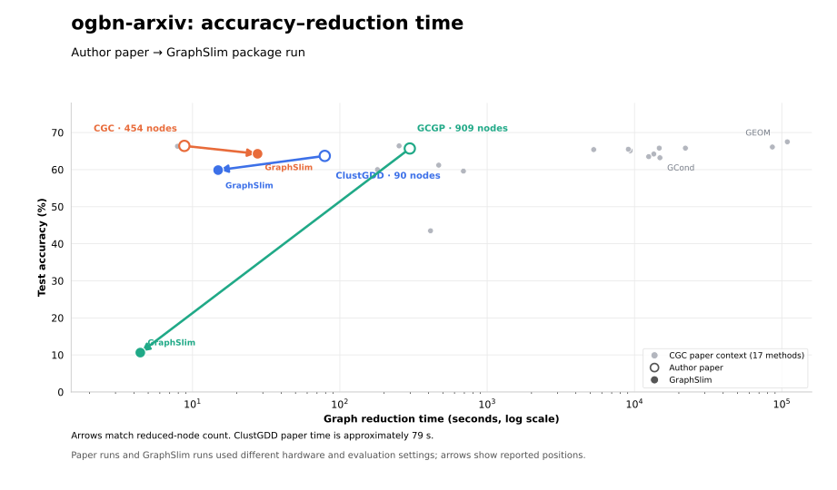

<div align="center">

# GraphSlim

[English](README.md) | [简体中文](README_zh-CN.md)

A PyTorch library for graph sparsification, coarsening, and condensation.

[Documentation](https://graphslim.readthedocs.io/en/latest/) ·
[GC4NC benchmark paper](https://arxiv.org/abs/2406.16715) ·
[Web interface](https://graphslim-vis.streamlit.app/) ·
[Paper collection](https://github.com/Emory-Melody/awesome-graph-reduction)


</div>

GraphSlim loads PyG graphs, reduces them with a shared method registry, and evaluates
the reduced graph using a common downstream GNN pipeline. The repository includes
the package, runnable examples, regression tests, and benchmark reproduction commands.

Acceleration uses native PyTorch operations and CUDA Graphs for NVIDIA A100
and newer GPUs across Ampere, Ada, Hopper and Blackwell. Enable it with
`--cuda_graph`. [GPU setup and checks](docs/compatibility.md#gpu-portability).

## ogbn-arxiv accuracy–time tradeoff

Gray points show 17 methods reported in the
[CGC paper](https://arxiv.org/html/2405.13707). Arrows show three methods
moving from their author-reported results (open circles) to measured
GraphSlim package results (filled circles) at matching reduced-node counts.
The plot has no error bars. GraphSlim's full [40-method roster](#methods) is below.



GCGP moves to a much shorter reduction time and a much lower test accuracy in
these records. The papers and GraphSlim runs used different hardware and GCN
settings. [Exact values, sources and protocol](docs/arxiv_tradeoff.md) ·
[Plot data](benchmark/results/arxiv_author_vs_graphslim_20261029.json) ·
[Products results](docs/products.md).

Use `graphslim-doctor` to check PyTorch, sparse operations and optional DGL.

```bash
python -m graphslim.doctor --device cuda:0 --dgl --json --output doctor.json
```

## Install

Use Python 3.10 or 3.11. Install PyTorch first for your CPU/CUDA environment, then
install matching PyG extension wheels. For example, a CPU development environment:

```bash
git clone https://github.com/Emory-Melody/GraphSlim.git
cd GraphSlim
uv venv --python 3.11
source .venv/bin/activate
uv pip install torch==2.6.0 torchvision==0.21.0 --index-url https://download.pytorch.org/whl/cpu
uv pip install torch-scatter torch-sparse --no-deps --no-index -f https://data.pyg.org/whl/torch-2.6.0+cpu.html
uv pip install -e ".[dev]" --constraint <(printf 'torch==2.6.0\ntorchvision==0.21.0\n')
```

For CUDA, choose matching PyTorch and extension wheels from
[PyTorch](https://pytorch.org/get-started/previous-versions/) and
[PyG](https://data.pyg.org/whl/). Keep the installed Torch version constrained while
installing the remaining dependencies. Install `.[dgl]` for the Yelp/Amazon fraud
datasets, `.[fuzzy]` for GECC's fuzzy clustering, and `.[viz]` for the web interface.
The extension-wheel step uses `--no-deps` because the PyG wheel directory does
not contain SciPy; the subsequent GraphSlim installation supplies dependencies.

The checked-in `uv.lock` records dependency resolution. `uv sync --locked` reads it;
`uv pip sync` requires a requirements file and does not consume `uv.lock`.
Compiled PyG extensions must still match the Torch/CUDA environment.

To use a published package instead of this checkout: `pip install graphslim`.

## Quick start

Run from the repository root. Data defaults to `./data`; use `--load_path` and
`--save_path` to select dataset and checkpoint locations. `-G -1` selects CPU;
nonnegative GPU IDs index devices already visible through `CUDA_VISIBLE_DEVICES`.

```bash
python -m graphslim.train_all -D cora -M clustering -G -1 --save_path ./checkpoints
python -m graphslim.train_all -D cora -M gcond -G 0 --save_path ./checkpoints
python -m graphslim.run_eval -D cora -M gcond -G 0 --save_path ./checkpoints
python -m graphslim.run_eval -D cora -W -G -1
python -m graphslim.train_all --help
```

Installed commands: `graphslim-train`, `graphslim-eval`, `graphslim-doctor`, and `graphslim-visualize`.
`--run_reduction N` uses consecutive seeds for N reductions; `--run_eval N`
controls downstream evaluation repetitions. `--run_reduction 0` evaluates a saved
graph, and `-W` evaluates the whole graph. Method JSON defaults load before explicit
CLI overrides. `--agg` (also `--aggpreprocess`) selects an aggregated variant where
available.

### Examples

Each example uses the same pipeline and loads defaults for its selected method.

```bash
python -m examples.train_node_sparsification -G -1
python -m examples.train_coarsen -G -1
python -m examples.train_gcond -G -1
```

Direct execution such as `python examples/train_gcond.py --help` also works from
any directory. Importing an example does not launch training.

### Package API

```python
from graphslim.config import get_args
from graphslim.train_all import run

args = get_args(
    [
        "-D",
        "cora",
        "-M",
        "gcond",
        "-G",
        "-1",
        "--run_reduction",
        "1",
        "--save_path",
        "./checkpoints",
    ]
)
results = run(args)  # one (mean, standard deviation) pair per reduction
```

For custom orchestration, use `graphslim.dataset.get_dataset`,
`graphslim.reduction.create_reducer`, and `graphslim.evaluation.Evaluator`.
Public method classes remain available, e.g. `from graphslim.condensation import GCond`.

## Methods

Discover canonical names with:

```python
from graphslim.reduction import list_methods

print(list_methods("condensation"))
```

| Family | Canonical method names |
| --- | --- |
| Node / edge sparsification | `random`, `kcenter`, `herding`, `cent_d`, `cent_p`, `random_edge`, `spanning_forest`, `g_spar`, `local_degree`, `rank_degree`, `scan`, `t_spanner` |
| Coarsening / clustering | `averaging`, `clustering`, `vng`, `variation_neighborhoods`, `variation_edges`, `variation_cliques`, `heavy_edge`, `algebraic_jc`, `affinity_gs`, `kron`, `nope` |
| Graph condensation | `gcond`, `gcondx`, `doscond`, `doscondx`, `gcdm`, `gcdmx`, `sfgc`, `geom`, `msgc`, `sgdd`, `gcsntk`, `gdem`, `simgc`, `gecc`, `cgc`, `clustgdd`, `gcgp` |

See each method's configuration for its settings, including GECC's evolving-graph
workflow.

CGC and NOPE reduce graphs without GNN training. ClustGDD uses linear pretraining
and refinement; GCGP uses a Gaussian process to optimize reduced features and
targets. [Method descriptions, sources and validation](docs/lightweight_methods.md).

```bash
python -m examples.train_lightweight -D cora -M cgc -G -1 --save_path ./checkpoints
python -m graphslim.train_all -D cora -M gcgp -G -1 --save_path ./checkpoints
```

Use `--config method_overrides.json` for method-specific options; explicit CLI
options take precedence. Public imports include `CGC`, `ClustGDD`, `GCGP` from
`graphslim.condensation` and `NOPE` from `graphslim.coarsening`.

## Reproduce the benchmark

The runner plans jobs without importing Torch and runs jobs serially when
`--dry-run` is omitted. Use the dry run to inspect the requested matrix:

```bash
python -m benchmark.reproduce performance --dry-run
python -m benchmark.reproduce performance --datasets cora citeseer --methods clustering gcond --dry-run
python -m benchmark.reproduce performance --datasets cora --methods clustering --skip-whole -- -G -1
bash benchmark/scripts/performance.sh --dry-run
```

The performance matrix covers all seven published datasets and all 19 methods in
Table 9, plus clustering and the four new lightweight extensions, followed by whole-graph baselines. Published OOM or missing
cells remain visible in the table; reruns may also fail for resource or method-specific
requirements. GEOM/SFGC paper performance used the authors' implementations; the local
expert-buffer defaults differ, so this package runner alone does not establish exact
reproduction of those published scores.

Other suites: `scalability`, `data_initialization`, `transferability`, `nas`,
`graph_property_preservation`, and `robustness`. The shell scripts in
[benchmark/scripts](benchmark/scripts) forward arguments to the same runner and
resolve their repository path independently of the caller's directory. Transferability,
NAS, and graph-property suites require saved reduced graphs. See
[benchmark/README.md](benchmark/README.md) for the paper-to-command mapping.

### Reduction rates

The CLI uses fractions of **labeled training nodes**. Table 9 prints percentages of
the original whole graph for transductive datasets and of the training graph for
inductive datasets. Preserve this distinction when reproducing a row.

| Dataset | Setting | CLI `-R` values | Table 9 rate labels (%) |
| --- | --- | --- | --- |
| Citeseer | Transductive | 0.1, 0.25, 0.5 | 0.36, 0.90, 1.80 |
| Cora | Transductive | 0.1, 0.25, 0.5 | 0.50, 1.30, 2.60 |
| Pubmed | Transductive | 0.05, 0.1, 0.5 | 0.02, 0.03, 0.15 |
| Arxiv (`ogbn-arxiv`) | Transductive | 0.001, 0.005, 0.01 | 0.05, 0.25, 0.50 |
| Flickr | Inductive | 0.001, 0.005, 0.01 | 0.10, 0.50, 1.00 |
| Reddit | Inductive | 0.0005, 0.001, 0.002 | 0.05, 0.10, 0.20 |
| Yelp | Inductive | 0.0005, 0.001, 0.002 | 0.05, 0.10, 0.20 |

The paper's Table 8 has inconsistent Pubmed percentages; the results below retain
Table 9's labels verbatim. CLI fractions produce per-class integer node budgets,
so rounded paper percentages need not equal the exact achieved rate.

## Full published performance results

Source: [GC4NC, arXiv:2406.16715v3, Table 9](https://arxiv.org/html/2406.16715v3#A1.T9)
(9 November 2025). These are **published measurements**, not results from the code
cleanup. All seven datasets and all three rates are included. Values and reported
`±` uncertainties are preserved verbatim; the source caption calls these standard
errors. Whole-graph baselines are repeated across rates for readability.

`OOM` means the source reports out of memory; `-` means no value is provided.
`NR` means the method is implemented but has no standalone result in this source:
Clustering, DosCondX, GCDM, SimGC, and GECC. In particular, the source's GCDMX values
are not assigned to GCDM. VN maps to `variation_neighborhoods`; TSpanner maps to
`t_spanner`. Additional sparsification/coarsening methods in the catalog also have
no published Table 9 scores.

For measured local completions of these `NR` methods, see the
[package coverage table](#package-measurements-completing-published-nr-coverage)
below. It includes clustering and all four additional condensation methods,
keeps repaired SimGC progress explicit, and does not rewrite the published CSV.

The [frozen CSV](benchmark/results/gc4nc_table9.csv) and
[source record](benchmark/results/provenance.json) retain the table's provenance.
Check or render the README tables with:

```bash
python -m benchmark.render_results --check
python -m benchmark.render_results
```

<!-- benchmark-results:start -->
### Citeseer — test accuracy (%)

| Family | Method | 0.36% | 0.90% | 1.80% |
| --- | --- | ---: | ---: | ---: |
| Coreset / sparsification | Cent-D | 42.86 ± 2.7 | 58.77 ± 0.5 | 62.89 ± 0.4 |
| Coreset / sparsification | Cent-P | 37.78 ± 1.3 | 52.83 ± 0.4 | 63.37 ± 0.4 |
| Coreset / sparsification | Random | 35.37 ± 2.8 | 50.71 ± 0.8 | 62.62 ± 0.6 |
| Coreset / sparsification | Herding | 43.73 ± 1.6 | 59.24 ± 0.4 | 66.66 ± 0.5 |
| Coreset / sparsification | K-Center | 41.43 ± 1.4 | 51.15 ± 1.1 | 59.04 ± 0.9 |
| Coreset / sparsification | TSpanner | 71.83 ± 0.3 | 71.62 ± 0.4 | 71.60 ± 0.4 |
| Coarsening | Averaging | 69.75 ± 0.6 | 69.59 ± 0.5 | 69.50 ± 0.6 |
| Coarsening | VN | 34.32 ± 5.9 | 40.14 ± 5.3 | 41.98 ± 7.0 |
| Coarsening | VNG | 66.14 ± 0.3 | 66.07 ± 0.4 | 65.34 ± 0.6 |
| Coarsening | Clustering | NR | NR | NR |
| Condensation | GEOM | 67.61 ± 0.7 | 70.70 ± 0.5 | 73.03 ± 0.3 |
| Condensation | SFGC | 66.27 ± 0.8 | 70.27 ± 0.7 | 72.36 ± 0.5 |
| Condensation | GCSNTK | 63.51 ± 1.9 | 62.91 ± 0.8 | 63.90 ± 3.4 |
| Condensation | GCDMX | 70.65 ± 0.5 | 71.27 ± 0.6 | 72.08 ± 0.2 |
| Condensation | GCondX | 67.79 ± 0.7 | 69.69 ± 0.5 | 68.38 ± 0.5 |
| Condensation | GCond | 70.05 ± 2.1 | 69.15 ± 1.2 | 69.35 ± 0.8 |
| Condensation | DosCond | 69.41 ± 0.8 | 70.83 ± 0.4 | 72.18 ± 0.6 |
| Condensation | MSGC | 60.24 ± 6.0 | 72.08 ± 0.7 | 72.21 ± 0.4 |
| Condensation | SGDD | 71.87 ± 0.6 | 70.52 ± 0.6 | 69.65 ± 1.7 |
| Condensation | GDEM | 67.88 ± 1.8 | 70.13 ± 1.1 | 71.74 ± 0.9 |
| Condensation | DosCondX | NR | NR | NR |
| Condensation | GCDM | NR | NR | NR |
| Condensation | SimGC | NR | NR | NR |
| Condensation | GECC | NR | NR | NR |
| Baseline | Whole | 72.6 | 72.6 | 72.6 |

### Cora — test accuracy (%)

| Family | Method | 0.50% | 1.30% | 2.60% |
| --- | --- | ---: | ---: | ---: |
| Coreset / sparsification | Cent-D | 57.79 ± 1.7 | 66.45 ± 2.2 | 75.79 ± 0.7 |
| Coreset / sparsification | Cent-P | 58.44 ± 1.7 | 66.38 ± 1.7 | 75.64 ± 1.6 |
| Coreset / sparsification | Random | 35.14 ± 2.5 | 63.63 ± 1.3 | 72.24 ± 0.6 |
| Coreset / sparsification | Herding | 51.68 ± 2.1 | 68.99 ± 0.7 | 73.77 ± 0.9 |
| Coreset / sparsification | K-Center | 44.64 ± 4.4 | 63.28 ± 1.4 | 70.55 ± 1.4 |
| Coreset / sparsification | TSpanner | 79.79 ± 0.4 | 80.84 ± 0.3 | 80.41 ± 0.3 |
| Coarsening | Averaging | 75.94 ± 0.7 | 75.87 ± 0.6 | 75.76 ± 1.1 |
| Coarsening | VN | 24.62 ± 5.7 | 51.07 ± 5.8 | 56.75 ± 5.4 |
| Coarsening | VNG | 70.40 ± 0.6 | 74.48 ± 0.5 | 76.03 ± 0.4 |
| Coarsening | Clustering | NR | NR | NR |
| Condensation | GEOM | 78.14 ± 0.5 | 82.29 ± 0.6 | 82.82 ± 0.2 |
| Condensation | SFGC | 75.11 ± 2.2 | 79.55 ± 0.3 | 80.54 ± 0.5 |
| Condensation | GCSNTK | 71.58 ± 0.9 | 71.22 ± 2.6 | 73.34 ± 0.6 |
| Condensation | GCDMX | 79.21 ± 0.4 | 80.26 ± 0.3 | 80.68 ± 0.3 |
| Condensation | GCondX | 79.74 ± 0.5 | 78.67 ± 0.4 | 78.60 ± 0.3 |
| Condensation | GCond | 80.17 ± 0.8 | 80.81 ± 0.5 | 80.54 ± 0.7 |
| Condensation | DosCond | 80.65 ± 0.6 | 80.85 ± 0.4 | 81.15 ± 0.5 |
| Condensation | MSGC | 80.54 ± 0.3 | 80.98 ± 0.5 | 80.94 ± 0.4 |
| Condensation | SGDD | 80.15 ± 0.5 | 80.29 ± 0.8 | 81.04 ± 0.5 |
| Condensation | GDEM | 54.76 ± 4.5 | 72.87 ± 1.8 | 81.76 ± 0.5 |
| Condensation | DosCondX | NR | NR | NR |
| Condensation | GCDM | NR | NR | NR |
| Condensation | SimGC | NR | NR | NR |
| Condensation | GECC | NR | NR | NR |
| Baseline | Whole | 81.5 | 81.5 | 81.5 |

### Pubmed — test accuracy (%)

| Family | Method | 0.02% | 0.03% | 0.15% |
| --- | --- | ---: | ---: | ---: |
| Coreset / sparsification | Cent-D | 56.16 ± 2.6 | 55.61 ± 1.6 | 71.95 ± 0.5 |
| Coreset / sparsification | Cent-P | 57.28 ± 1.2 | 62.50 ± 1.0 | 73.35 ± 0.4 |
| Coreset / sparsification | Random | 49.46 ± 1.6 | 56.10 ± 1.8 | 71.84 ± 0.7 |
| Coreset / sparsification | Herding | 62.91 ± 1.5 | 69.28 ± 1.6 | 75.53 ± 0.4 |
| Coreset / sparsification | K-Center | 79.18 ± 0.2 | 65.59 ± 2.4 | 74.00 ± 0.2 |
| Coreset / sparsification | TSpanner | 62.91 ± 1.5 | 79.39 ± 0.3 | 78.39 ± 0.2 |
| Coarsening | Averaging | 74.09 ± 0.6 | 75.60 ± 0.4 | 75.60 ± 0.4 |
| Coarsening | VN | 75.60 ± 0.4 | 74.09 ± 0.6 | 73.68 ± 1.6 |
| Coarsening | VNG | 75.60 ± 0.4 | 75.72 ± 0.3 | 77.53 ± 0.5 |
| Coarsening | Clustering | NR | NR | NR |
| Condensation | GEOM | 69.64 ± 1.4 | 76.21 ± 0.7 | 78.49 ± 0.2 |
| Condensation | SFGC | 67.61 ± 2.0 | 66.89 ± 3.3 | 67.61 ± 4.1 |
| Condensation | GCSNTK | 29.45 ± 10.9 | 68.37 ± 3.0 | 69.89 ± 2.2 |
| Condensation | GCDMX | 77.62 ± 0.2 | 76.63 ± 1.2 | 77.48 ± 0.5 |
| Condensation | GCondX | 72.03 ± 1.6 | 72.05 ± 1.6 | 71.97 ± 0.5 |
| Condensation | GCond | 77.36 ± 0.7 | 78.05 ± 0.3 | 76.46 ± 0.5 |
| Condensation | DosCond | 58.13 ± 2.2 | 52.70 ± 0.3 | 76.45 ± 0.1 |
| Condensation | MSGC | 75.25 ± 0.7 | 78.26 ± 0.3 | 78.20 ± 0.2 |
| Condensation | SGDD | 78.11 ± 0.3 | 78.07 ± 0.3 | 75.95 ± 0.3 |
| Condensation | GDEM | 77.52 ± 0.7 | 78.05 ± 1.3 | 78.76 ± 1.1 |
| Condensation | DosCondX | NR | NR | NR |
| Condensation | GCDM | NR | NR | NR |
| Condensation | SimGC | NR | NR | NR |
| Condensation | GECC | NR | NR | NR |
| Baseline | Whole | 78.6 | 78.6 | 78.6 |

### Arxiv — test accuracy (%)

| Family | Method | 0.05% | 0.25% | 0.50% |
| --- | --- | ---: | ---: | ---: |
| Coreset / sparsification | Cent-D | 32.88 ± 2.7 | 48.85 ± 1.1 | 52.01 ± 0.5 |
| Coreset / sparsification | Cent-P | 36.48 ± 2.0 | 47.90 ± 0.9 | 55.65 ± 0.5 |
| Coreset / sparsification | Random | 50.39 ± 1.4 | 58.92 ± 0.8 | 60.19 ± 0.5 |
| Coreset / sparsification | Herding | 51.49 ± 0.7 | 58.00 ± 0.5 | 57.70 ± 0.2 |
| Coreset / sparsification | K-Center | 50.52 ± 0.5 | 55.28 ± 0.6 | 58.66 ± 0.4 |
| Coreset / sparsification | TSpanner | - | - | - |
| Coarsening | Averaging | 59.62 ± 0.4 | 59.96 ± 0.3 | 59.94 ± 0.3 |
| Coarsening | VN | OOM | OOM | OOM |
| Coarsening | VNG | 54.89 ± 0.3 | 59.66 ± 0.2 | 60.93 ± 0.2 |
| Coarsening | Clustering | NR | NR | NR |
| Condensation | GEOM | 64.91 ± 0.4 | 68.78 ± 0.1 | 69.59 ± 0.2 |
| Condensation | SFGC | 64.91 ± 0.5 | 66.58 ± 0.3 | 67.03 ± 0.5 |
| Condensation | GCSNTK | 58.21 ± 1.7 | 59.98 ± 1.7 | 54.73 ± 5.0 |
| Condensation | GCDMX | 60.04 ± 0.4 | 60.59 ± 0.4 | 60.71 ± 0.7 |
| Condensation | GCondX | 59.40 ± 0.5 | 62.46 ± 0.3 | 59.93 ± 0.5 |
| Condensation | GCond | 60.49 ± 0.4 | 63.88 ± 0.2 | 64.23 ± 0.2 |
| Condensation | DosCond | 55.70 ± 0.3 | 57.39 ± 0.2 | 61.06 ± 0.6 |
| Condensation | MSGC | 57.66 ± 0.4 | 64.85 ± 0.3 | 65.73 ± 0.2 |
| Condensation | SGDD | 58.50 ± 0.2 | 59.18 ± 0.2 | 63.76 ± 0.2 |
| Condensation | GDEM | - | - | - |
| Condensation | DosCondX | NR | NR | NR |
| Condensation | GCDM | NR | NR | NR |
| Condensation | SimGC | NR | NR | NR |
| Condensation | GECC | NR | NR | NR |
| Baseline | Whole | 71.4 | 71.4 | 71.4 |

### Flickr — test accuracy (%)

| Family | Method | 0.10% | 0.50% | 1.00% |
| --- | --- | ---: | ---: | ---: |
| Coreset / sparsification | Cent-D | 40.70 ± 0.4 | 42.90 ± 0.3 | 42.62 ± 0.2 |
| Coreset / sparsification | Cent-P | 40.97 ± 0.9 | 44.06 ± 0.3 | 44.51 ± 0.3 |
| Coreset / sparsification | Random | 42.94 ± 0.3 | 44.54 ± 0.5 | 44.68 ± 0.6 |
| Coreset / sparsification | Herding | 42.80 ± 0.1 | 43.86 ± 0.5 | 45.12 ± 0.4 |
| Coreset / sparsification | K-Center | 43.01 ± 0.5 | 43.46 ± 0.8 | 43.53 ± 0.6 |
| Coreset / sparsification | TSpanner | - | - | - |
| Coarsening | Averaging | 37.93 ± 0.3 | 37.76 ± 0.4 | 37.66 ± 0.3 |
| Coarsening | VN | 32.77 ± 5.7 | 33.79 ± 5.2 | 34.39 ± 6.0 |
| Coarsening | VNG | 44.33 ± 0.3 | 43.30 ± 0.6 | 43.84 ± 0.8 |
| Coarsening | Clustering | NR | NR | NR |
| Condensation | GEOM | 47.15 ± 0.1 | 46.71 ± 0.2 | 46.13 ± 0.2 |
| Condensation | SFGC | 46.38 ± 0.2 | 46.38 ± 0.2 | 46.61 ± 0.1 |
| Condensation | GCSNTK | 41.85 ± 3.1 | 33.39 ± 6.0 | 31.12 ± 4.2 |
| Condensation | GCDMX | 43.75 ± 0.3 | 45.05 ± 0.3 | 45.88 ± 0.1 |
| Condensation | GCondX | 46.66 ± 0.1 | 46.69 ± 0.1 | 46.58 ± 0.1 |
| Condensation | GCond | 46.75 ± 0.1 | 47.01 ± 0.2 | 46.99 ± 0.1 |
| Condensation | DosCond | 45.87 ± 0.3 | 45.89 ± 0.3 | 45.81 ± 0.1 |
| Condensation | MSGC | 46.21 ± 0.1 | 46.77 ± 0.1 | 46.12 ± 0.2 |
| Condensation | SGDD | 46.69 ± 0.1 | 46.39 ± 0.2 | 46.24 ± 0.3 |
| Condensation | GDEM | - | - | - |
| Condensation | DosCondX | NR | NR | NR |
| Condensation | GCDM | NR | NR | NR |
| Condensation | SimGC | NR | NR | NR |
| Condensation | GECC | NR | NR | NR |
| Baseline | Whole | 47.4 | 47.4 | 47.4 |

### Reddit — test accuracy (%)

| Family | Method | 0.05% | 0.10% | 0.20% |
| --- | --- | ---: | ---: | ---: |
| Coreset / sparsification | Cent-D | 40.00 ± 1.1 | 50.47 ± 1.4 | 55.31 ± 1.8 |
| Coreset / sparsification | Cent-P | 45.83 ± 1.7 | 51.22 ± 1.4 | 61.56 ± 0.2 |
| Coreset / sparsification | Random | 40.13 ± 0.9 | 55.73 ± 0.5 | 58.39 ± 2.3 |
| Coreset / sparsification | Herding | 46.88 ± 0.4 | 59.34 ± 0.7 | 73.46 ± 0.5 |
| Coreset / sparsification | K-Center | 40.24 ± 0.8 | 48.28 ± 0.7 | 56.81 ± 1.7 |
| Coreset / sparsification | TSpanner | - | - | - |
| Coarsening | Averaging | 88.23 ± 0.1 | 88.32 ± 0.1 | 88.33 ± 0.1 |
| Coarsening | VN | OOM | OOM | OOM |
| Coarsening | VNG | 69.96 ± 0.5 | 76.95 ± 0.2 | 81.52 ± 0.6 |
| Coarsening | Clustering | NR | NR | NR |
| Condensation | GEOM | 90.63 ± 0.2 | 91.33 ± 0.1 | 91.03 ± 0.3 |
| Condensation | SFGC | 90.18 ± 0.2 | 89.84 ± 0.3 | 90.71 ± 0.1 |
| Condensation | GCSNTK | OOM | OOM | OOM |
| Condensation | GCDMX | 87.28 ± 0.2 | 89.96 ± 0.1 | 89.08 ± 0.1 |
| Condensation | GCondX | 86.56 ± 0.2 | 88.25 ± 0.3 | 88.73 ± 0.2 |
| Condensation | GCond | 85.39 ± 0.2 | 89.82 ± 0.1 | 90.42 ± 0.1 |
| Condensation | DosCond | 86.56 ± 0.4 | 88.32 ± 0.2 | 88.84 ± 0.2 |
| Condensation | MSGC | 87.62 ± 0.1 | 88.15 ± 0.1 | 87.03 ± 0.1 |
| Condensation | SGDD | 87.37 ± 0.2 | 88.73 ± 0.3 | 90.65 ± 0.1 |
| Condensation | GDEM | - | - | - |
| Condensation | DosCondX | NR | NR | NR |
| Condensation | GCDM | NR | NR | NR |
| Condensation | SimGC | NR | NR | NR |
| Condensation | GECC | NR | NR | NR |
| Baseline | Whole | 94.4 | 94.4 | 94.4 |

### Yelp — F1-macro (%)

| Family | Method | 0.05% | 0.10% | 0.20% |
| --- | --- | ---: | ---: | ---: |
| Coreset / sparsification | Cent-D | 48.67 ± 0.3 | 51.03 ± 0.1 | 46.08 ± 0.0 |
| Coreset / sparsification | Cent-P | 46.81 ± 0.1 | 46.08 ± 0.0 | 46.08 ± 0.0 |
| Coreset / sparsification | Random | 46.08 ± 0.0 | 46.28 ± 0.1 | 49.31 ± 0.4 |
| Coreset / sparsification | Herding | 46.08 ± 0.0 | 52.23 ± 0.3 | 47.49 ± 0.1 |
| Coreset / sparsification | K-Center | 46.07 ± 0.0 | 46.22 ± 0.0 | 46.85 ± 0.2 |
| Coreset / sparsification | TSpanner | - | - | - |
| Coarsening | Averaging | 55.04 ± 0.1 | 53.51 ± 0.8 | 54.42 ± 0.3 |
| Coarsening | VN | 51.52 ± 1.6 | 51.68 ± 1.0 | 52.63 ± 1.1 |
| Coarsening | VNG | 49.24 ± 0.1 | 47.33 ± 0.5 | 48.63 ± 0.4 |
| Coarsening | Clustering | NR | NR | NR |
| Condensation | GEOM | 52.80 ± 2.2 | 47.56 ± 0.2 | 49.48 ± 0.7 |
| Condensation | SFGC | 46.20 ± 0.1 | 47.96 ± 0.0 | 46.70 ± 0.1 |
| Condensation | GCSNTK | OOM | OOM | OOM |
| Condensation | GCDMX | 50.75 ± 0.4 | 52.49 ± 0.1 | 55.89 ± 0.2 |
| Condensation | GCondX | 52.44 ± 0.4 | 49.70 ± 1.5 | 48.77 ± 1.3 |
| Condensation | GCond | 52.30 ± 0.1 | 53.22 ± 0.1 | 51.76 ± 0.2 |
| Condensation | DosCond | 51.10 ± 0.3 | 52.54 ± 0.1 | 52.19 ± 0.5 |
| Condensation | MSGC | 52.94 ± 0.2 | 50.97 ± 0.8 | 51.35 ± 0.5 |
| Condensation | SGDD | 52.02 ± 0.2 | 54.13 ± 0.2 | 52.86 ± 0.1 |
| Condensation | GDEM | - | - | - |
| Condensation | DosCondX | NR | NR | NR |
| Condensation | GCDM | NR | NR | NR |
| Condensation | SimGC | NR | NR | NR |
| Condensation | GECC | NR | NR | NR |
| Baseline | Whole | 58.2 | 58.2 | 58.2 |
<!-- benchmark-results:end -->

<!-- local-nr-results:start -->

### Local NR rerun (separate from published Table 9)

Progress: 306/315 reduction runs complete; 0 failed; 9 require configuration.

Each numeric cell requires all 3 reduction seeds × 10 downstream GCN fits, 300 evaluation epochs, 256 hidden units and 2 layers. Values are mean ± population standard deviation over the 30 test scores, in percent (Yelp: F1-macro). Synthetic checkpoints and GCN weights are selected on validation performance only. No incomplete cell is averaged or ranked.

CLI rates below are fractions of labeled training nodes, not the whole-graph percentages printed in the published tables. Dataset splits are fixed with data seed 1; reduction seeds are 1, 2, 3. Method epochs and hyperparameters come from this repository's JSON configurations. GECC uses its implemented static mode (no evolving splits); its missing Yelp configuration is `CONFIG`, not a score.

These are local reruns of the repository, not an exact replay of the published experiment: the Reddit loader uses the sparser Reddit2 variant; FraudYelp receives the repository's seeded classwise 80/10/10 split. See per-run dataset hashes/counts and resolved configurations for the exact inputs.

| Dataset | CLI rate | Clustering | DosCondX | GCDM | SimGC | GECC |
| --- | ---: | ---: | ---: | ---: | ---: | ---: |
| cora | 0.1 | 73.74 ± 0.65 | 78.98 ± 0.54 | 78.40 ± 1.01 | 71.31 ± 5.12 | 81.93 ± 0.73 |
| cora | 0.25 | 75.46 ± 0.71 | 78.38 ± 0.52 | 79.59 ± 0.62 | 68.58 ± 11.56 | 82.81 ± 0.22 |
| cora | 0.5 | 77.31 ± 0.43 | 79.25 ± 0.78 | 80.90 ± 0.45 | 75.01 ± 4.30 | 82.53 ± 0.41 |
| citeseer | 0.1 | 69.78 ± 0.48 | 70.45 ± 1.27 | 71.25 ± 0.94 | 24.16 ± 4.18 | 73.06 ± 0.31 |
| citeseer | 0.25 | 69.35 ± 0.30 | 70.06 ± 1.03 | 71.21 ± 0.80 | 22.95 ± 5.34 | 73.01 ± 0.31 |
| citeseer | 0.5 | 69.14 ± 0.24 | 70.86 ± 0.99 | 71.96 ± 0.57 | 29.00 ± 7.06 | 72.89 ± 0.27 |
| pubmed | 0.05 | 75.56 ± 0.40 | 72.53 ± 1.54 | 77.65 ± 0.31 | 43.37 ± 3.93 | 75.09 ± 0.19 |
| pubmed | 0.1 | 75.10 ± 0.75 | 71.26 ± 1.43 | 77.39 ± 1.44 | 39.82 ± 5.56 | 77.71 ± 0.23 |
| pubmed | 0.5 | 76.46 ± 0.47 | 71.84 ± 1.26 | 76.76 ± 0.58 | 37.76 ± 10.11 | 80.20 ± 0.40 |
| ogbn-arxiv | 0.001 | 60.84 ± 0.53 | 60.42 ± 0.59 | 59.97 ± 0.46 | 56.15 ± 2.03 | 61.38 ± 0.55 |
| ogbn-arxiv | 0.005 | 61.95 ± 0.20 | 62.21 ± 0.98 | 60.59 ± 0.42 | 60.32 ± 0.40 | 64.92 ± 0.26 |
| ogbn-arxiv | 0.01 | 63.13 ± 0.17 | 61.75 ± 0.54 | 60.67 ± 0.48 | 60.39 ± 0.39 | 66.38 ± 0.35 |
| flickr | 0.001 | 46.04 ± 0.25 | 46.63 ± 0.22 | 43.56 ± 1.06 | 45.93 ± 0.26 | 46.33 ± 0.25 |
| flickr | 0.005 | 46.27 ± 0.31 | 46.64 ± 0.19 | 45.07 ± 0.61 | 41.99 ± 2.29 | 45.88 ± 0.22 |
| flickr | 0.01 | 45.70 ± 0.26 | 46.62 ± 0.16 | 45.33 ± 0.65 | 42.76 ± 1.56 | 46.18 ± 0.24 |
| reddit | 0.0005 | 89.44 ± 0.11 | 54.07 ± 3.38 | 86.88 ± 0.37 | 61.77 ± 28.60 | 89.50 ± 0.09 |
| reddit | 0.001 | 90.03 ± 0.18 | 56.83 ± 1.50 | 88.48 ± 0.44 | 79.20 ± 10.17 | 90.89 ± 0.09 |
| reddit | 0.002 | 91.57 ± 0.06 | 58.02 ± 1.31 | 89.92 ± 0.12 | 81.13 ± 7.56 | 91.63 ± 0.11 |
| yelp | 0.0005 | 53.63 ± 0.36 | 51.15 ± 1.07 | 51.77 ± 1.47 | 49.26 ± 2.46 | CONFIG |
| yelp | 0.001 | 53.69 ± 0.19 | 51.09 ± 1.20 | 53.43 ± 1.75 | 49.78 ± 2.78 | CONFIG |
| yelp | 0.002 | 52.45 ± 0.22 | 50.53 ± 0.73 | 53.87 ± 0.55 | 52.51 ± 3.38 | CONFIG |

`PENDING (n/3)` retains partial reductions without publishing a partial score. `FAILED`/`INTERRUPTED` retains an error record; `CONFIG` requires method configuration. Machine-readable scores, configurations, dataset hashes, source snapshot, checkpoint hashes, and logs are in the run directory.

<!-- local-nr-results:end -->

<!-- paper-hpo-results:start -->

### Paper-sourced HPO (new local batch; earlier untuned results retained)

Jobs: 367/367 complete; 0 running; 0 failed.

Completed validation candidates: GECC 4394/4394; SimGC downstream GCN 756/756.

GECC–Yelp: exhaustive 4,394 settings (13³ propagation weights × 2 weight decays), K=2, hard k-means++, one restart. SimGC: corrected author implementation/settings, then the 108-config downstream GCN grid from GC4NC Table 11. These are different search spaces, not interchangeable.

Searches use only validation metrics, ten fixed evaluation seeds, 300 epochs, and the seed-1 graph at the highest CLI reduction rate. A group must finish every candidate before its choice is frozen. That choice is reused across all three rates; each final cell requires 3 reduction seeds × 10 GCN fits. Values are test mean ± population standard deviation (%) (Yelp: F1-macro).

Scope caveats: GECC has no published Yelp optimum; SimGC has no published Pubmed/Yelp optimum (common author defaults are extensions). Reddit uses Reddit2; FraudYelp uses the fixed local seed-1 split. SimGC synthetic alignment gradients, teacher propagation order/normalization, and smoothness sign were repaired against the pinned author code. GECC inductive propagation depth and downstream training-mode dropout were repaired. Do not interpret this batch as a hyperparameter-only comparison or an exact paper replay.

Sources: [GECC §5.1](https://arxiv.org/html/2502.17614#S5.SS1), [GC4NC Table 11](https://arxiv.org/html/2406.16715v3#A1.SS8.SSS2), [SimGC §5.1](https://arxiv.org/html/2403.14951#S5.SS1), [pinned SimGC code](https://github.com/BangHonor/SimGC/tree/1b3d1d59d9afaf2c9c0c7b652fb183db2a5ffa01).

| Dataset | CLI rate | SimGC (author settings + GCN HPO) | GECC (paper grid, Yelp extension) |
| --- | ---: | ---: | ---: |
| citeseer | 0.1 | 44.48 ± 13.99 | — |
| citeseer | 0.25 | 47.25 ± 13.15 | — |
| citeseer | 0.5 | 49.77 ± 9.35 | — |
| cora | 0.1 | 25.71 ± 7.39 | — |
| cora | 0.25 | 25.25 ± 6.32 | — |
| cora | 0.5 | 33.40 ± 5.08 | — |
| pubmed | 0.05 | 63.08 ± 14.26 | — |
| pubmed | 0.1 | 67.57 ± 8.54 | — |
| pubmed | 0.5 | 72.76 ± 2.32 | — |
| ogbn-arxiv | 0.001 | 60.85 ± 0.41 | — |
| ogbn-arxiv | 0.005 | 63.08 ± 0.42 | — |
| ogbn-arxiv | 0.01 | 63.05 ± 0.69 | — |
| flickr | 0.001 | 46.20 ± 0.32 | — |
| flickr | 0.005 | 46.24 ± 0.29 | — |
| flickr | 0.01 | 45.59 ± 1.37 | — |
| reddit | 0.0005 | 88.07 ± 0.47 | — |
| reddit | 0.001 | 89.01 ± 0.25 | — |
| reddit | 0.002 | 90.06 ± 0.23 | — |
| yelp | 0.0005 | 47.41 ± 1.55 | 47.71 ± 2.86 |
| yelp | 0.001 | 47.56 ± 1.52 | 50.69 ± 2.92 |
| yelp | 0.002 | 47.54 ± 1.77 | 53.94 ± 0.41 |

Artifacts: `runs/paper_hpo_20261010_v2` (manifest, frozen source, raw validation scores, selections, test records, checkpoint hashes and logs). `PENDING` is not a numeric result.

<!-- paper-hpo-results:end -->

### SimGC citation package correction (2026-10-10)

The archived HPO table above predates a further Cora/Citeseer compatibility fix:
its generic ReLU GCN and 300-epoch budget did not match the released citation
evaluation branch. Its SimGC citation values are historical failed-reproduction
results, not evidence of the method's published performance. The old table,
source snapshot and raw scores are retained unchanged.

Current package defaults honor `activation=None` (or CLI `--activation none`),
use the author's separate hidden-2048 graph-selection and hidden-1024 downstream
GCNs, and preserve zero dropout/weight decay, constant lr=0.001 and the released
validation cadence. Graph selection uses 3,000 updates; final evaluation uses
3,001, matching the author's inclusive final loop. Future HPO retains the 108
GC4NC candidates and adds the released baseline for Cora/Citeseer. See
[the SimGC protocol](docs/simgc.md) for commands and validation boundaries.

The citation profile also uses raw features (`pre_norm=false`), matching the
author's effective `dataset.data` conversion that bypasses the attached feature
transform. This method-specific preprocessing difference is explicit; other
methods' loader defaults are unchanged. SimGC allocates synthetic nodes using
the author's per-class ceiling rather than the generic floor-based budget.

No repaired test result is claimed by this correction note. The validation-only
integration check is separate from benchmark tables. Fresh full-budget checks
at rate 0.5, reduction seed 1 / downstream seed 0 produced validation accuracy
of [72.6% on Cora](runs/simgc_fix_cora_20261010_v2/result.json) and
[51.8% on Citeseer](runs/simgc_fix_citeseer_20261010_v2/result.json). Both matched
the pinned author input converter and model forward/gradient checks. These
single-seed validation scores do not establish paper-level reproduction; new
multi-seed test evaluation is still required.

<!-- repaired-hpo-results:start -->

### Repaired package HPO (fresh source; historical batches retained)

Jobs: 191/191 complete; 0 running; 0 failed.

Completed validation candidates: GECC 0/0; SimGC downstream GCN 758/758.

No new GECC search in this batch; completed GECC results remain in their historical source batch. SimGC: 108 GC4NC downstream GCN candidates per dataset plus the released baseline for Cora/Citeseer (109 each).

Validation-only search with ten fixed evaluation seeds; Cora/Citeseer use the released no-activation GCN profile (3,001 downstream updates, validation every 100); others use the 300-epoch local protocol. Condensation selection is separate (citation: hidden 2048, 3,000 updates). Full groups freeze before testing. Final cells pool 3 reduction seeds × 10 GCN fits, test mean ± population standard deviation (%; Yelp: F1-macro).

Scope caveats: GECC has no published Yelp optimum; SimGC has no published Pubmed/Yelp optimum (common author defaults are extensions). Reddit uses Reddit2; FraudYelp uses the fixed local seed-1 split. SimGC synthetic alignment gradients, teacher propagation order/normalization, and smoothness sign were repaired against the pinned author code. GECC inductive propagation depth and downstream training-mode dropout were repaired. Do not interpret this batch as a hyperparameter-only comparison or an exact paper replay. Cora/Citeseer now use the released effective raw features, separate citation model profiles and Glorot initialization; SimGC uses per-class ceiling budgets. These method-specific repairs change the scientific protocol; do not rank across source batches as one controlled experiment.

Sources: [GECC §5.1](https://arxiv.org/html/2502.17614#S5.SS1), [GC4NC Table 11](https://arxiv.org/html/2406.16715v3#A1.SS8.SSS2), [SimGC §5.1](https://arxiv.org/html/2403.14951#S5.SS1), [pinned SimGC code](https://github.com/BangHonor/SimGC/tree/1b3d1d59d9afaf2c9c0c7b652fb183db2a5ffa01).

| Dataset | CLI rate | SimGC (author settings + GCN HPO) | GECC (paper grid, Yelp extension) |
| --- | ---: | ---: | ---: |
| citeseer | 0.1 | 42.13 ± 5.38 | — |
| citeseer | 0.25 | 51.92 ± 8.36 | — |
| citeseer | 0.5 | 50.87 ± 4.53 | — |
| cora | 0.1 | 57.80 ± 16.33 | — |
| cora | 0.25 | 77.97 ± 2.72 | — |
| cora | 0.5 | 78.13 ± 2.32 | — |
| pubmed | 0.05 | 72.19 ± 2.35 | — |
| pubmed | 0.1 | 68.03 ± 6.62 | — |
| pubmed | 0.5 | 72.44 ± 1.96 | — |
| ogbn-arxiv | 0.001 | 61.41 ± 0.63 | — |
| ogbn-arxiv | 0.005 | 62.91 ± 0.99 | — |
| ogbn-arxiv | 0.01 | 62.61 ± 0.90 | — |
| flickr | 0.001 | 46.21 ± 0.32 | — |
| flickr | 0.005 | 46.26 ± 0.34 | — |
| flickr | 0.01 | 46.29 ± 0.36 | — |
| reddit | 0.0005 | 87.12 ± 0.66 | — |
| reddit | 0.001 | 89.11 ± 0.31 | — |
| reddit | 0.002 | 90.33 ± 0.11 | — |
| yelp | 0.0005 | 47.85 ± 1.34 | — |
| yelp | 0.001 | 47.67 ± 1.69 | — |
| yelp | 0.002 | 47.71 ± 1.62 | — |

Artifacts: `/home/sgong36/gslim/runs/simgc_repaired_hpo_20261010` (manifest, frozen source, raw validation scores, selections, test records, checkpoint hashes and logs). `PENDING` is not a numeric result.

<!-- repaired-hpo-results:end -->

<!-- package-results:start -->

## Package measurements completing published NR coverage

Complete local cells: 105/105 (7 datasets × 3 CLI rates × 5 methods).
Only cells with all 3 reduction seeds × 10 downstream test fits are numeric.
Values are test mean ± population standard deviation (%), not the published
table's reported standard errors. Yelp uses F1-macro; all other rows use accuracy.
Pending repaired SimGC cells do not fall back to superseded measurements.

This is an explicitly source-scoped coverage table, not a controlled ranking:
NR methods use the archived fixed-GCN protocol; GECC–Yelp uses paper-grid HPO;
SimGC uses a fresh repaired source and validation-only GCN HPO (citation raw
features/no-activation/3,001 updates; other datasets 300 updates). Source
code, preprocessing, training budgets and evaluation seed schedules differ.
Published results and earlier local batches remain separately preserved above.

| Dataset | CLI rate | Clustering | DosCondX | GCDM | SimGC (repaired HPO) | GECC |
| --- | ---: | ---: | ---: | ---: | ---: | ---: |
| citeseer | 0.1 | 69.78 ± 0.48 | 70.45 ± 1.27 | 71.25 ± 0.94 | 42.13 ± 5.38 | 73.06 ± 0.31 |
| citeseer | 0.25 | 69.35 ± 0.30 | 70.06 ± 1.03 | 71.21 ± 0.80 | 51.92 ± 8.36 | 73.01 ± 0.31 |
| citeseer | 0.5 | 69.14 ± 0.24 | 70.86 ± 0.99 | 71.96 ± 0.57 | 50.87 ± 4.53 | 72.89 ± 0.27 |
| cora | 0.1 | 73.74 ± 0.65 | 78.98 ± 0.54 | 78.40 ± 1.01 | 57.80 ± 16.33 | 81.93 ± 0.73 |
| cora | 0.25 | 75.46 ± 0.71 | 78.38 ± 0.52 | 79.59 ± 0.62 | 77.97 ± 2.72 | 82.81 ± 0.22 |
| cora | 0.5 | 77.31 ± 0.43 | 79.25 ± 0.78 | 80.90 ± 0.45 | 78.13 ± 2.32 | 82.53 ± 0.41 |
| pubmed | 0.05 | 75.56 ± 0.40 | 72.53 ± 1.54 | 77.65 ± 0.31 | 72.19 ± 2.35 | 75.09 ± 0.19 |
| pubmed | 0.1 | 75.10 ± 0.75 | 71.26 ± 1.43 | 77.39 ± 1.44 | 68.03 ± 6.62 | 77.71 ± 0.23 |
| pubmed | 0.5 | 76.46 ± 0.47 | 71.84 ± 1.26 | 76.76 ± 0.58 | 72.44 ± 1.96 | 80.20 ± 0.40 |
| ogbn-arxiv | 0.001 | 60.84 ± 0.53 | 60.42 ± 0.59 | 59.97 ± 0.46 | 61.41 ± 0.63 | 61.38 ± 0.55 |
| ogbn-arxiv | 0.005 | 61.95 ± 0.20 | 62.21 ± 0.98 | 60.59 ± 0.42 | 62.91 ± 0.99 | 64.92 ± 0.26 |
| ogbn-arxiv | 0.01 | 63.13 ± 0.17 | 61.75 ± 0.54 | 60.67 ± 0.48 | 62.61 ± 0.90 | 66.38 ± 0.35 |
| flickr | 0.001 | 46.04 ± 0.25 | 46.63 ± 0.22 | 43.56 ± 1.06 | 46.21 ± 0.32 | 46.33 ± 0.25 |
| flickr | 0.005 | 46.27 ± 0.31 | 46.64 ± 0.19 | 45.07 ± 0.61 | 46.26 ± 0.34 | 45.88 ± 0.22 |
| flickr | 0.01 | 45.70 ± 0.26 | 46.62 ± 0.16 | 45.33 ± 0.65 | 46.29 ± 0.36 | 46.18 ± 0.24 |
| reddit | 0.0005 | 89.44 ± 0.11 | 54.07 ± 3.38 | 86.88 ± 0.37 | 87.12 ± 0.66 | 89.50 ± 0.09 |
| reddit | 0.001 | 90.03 ± 0.18 | 56.83 ± 1.50 | 88.48 ± 0.44 | 89.11 ± 0.31 | 90.89 ± 0.09 |
| reddit | 0.002 | 91.57 ± 0.06 | 58.02 ± 1.31 | 89.92 ± 0.12 | 90.33 ± 0.11 | 91.63 ± 0.11 |
| yelp | 0.0005 | 53.63 ± 0.36 | 51.15 ± 1.07 | 51.77 ± 1.47 | 47.85 ± 1.34 | 47.71 ± 2.86 |
| yelp | 0.001 | 53.69 ± 0.19 | 51.09 ± 1.20 | 53.43 ± 1.75 | 47.67 ± 1.69 | 50.69 ± 2.92 |
| yelp | 0.002 | 52.45 ± 0.22 | 50.53 ± 0.73 | 53.87 ± 0.55 | 47.71 ± 1.62 | 53.94 ± 0.41 |

Source assignment (no scores pooled across batches):

- `clustering, doscondx, gcdm, gecc` on `citeseer, cora, pubmed, ogbn-arxiv, flickr, reddit, yelp`: `runs/nr_20261009_v2` — NR batch: fixed GCN, 300 updates.
- `gecc` on `yelp`: `runs/paper_hpo_20261010_v2` — Completed GECC Yelp paper-grid search.
- `simgc` on `citeseer, cora, pubmed, ogbn-arxiv, flickr, reddit, yelp`: `runs/simgc_repaired_hpo_20261010` — Repaired SimGC: fresh reductions and validation-only GCN search.

[Machine-readable coverage and per-cell provenance](benchmark/results/package_local_results.json);
[CSV export](benchmark/results/package_local_results.csv). `PENDING`/`FAILED`/`CONFIG`
are unavailable results, not zero. Published `NR` means absent from the paper,
not absent from this local coverage table. Raw artifacts live in the listed run directories.

<!-- package-results:end -->

## Lightweight methods: downstream validation

The [dataset expansion](docs/dataset_expansion.md) uses three reduction seeds and
ten GCN seeds per rate. [Completed Products results](docs/products.md) include
CGC, ClustGDD, GCGP and Random at all three rates.

Method checks cover seven downstream architectures, transductive and inductive
settings, noise, saved-graph reloads and validation-based model selection.
[Method settings and checks](docs/lightweight_methods.md).

```bash
python -m benchmark.lightweight_downstream --run-dir runs/lightweight_cora --dry-run
python -m benchmark.lightweight_downstream --run-dir runs/lightweight_cora --profile smoke
python -m benchmark.reproduce robustness --datasets cora --methods cgc clustgdd gcgp nope --dry-run
```

<!-- lightweight-checks:start -->

The short Cora checks use 20 reduction and downstream updates, hidden size 32,
and one reduction/evaluation seed. [Check results (CSV)](benchmark/results/lightweight_integration.csv) ·
[Settings and verification records (JSON)](benchmark/results/lightweight_integration.json).

<!-- lightweight-checks:end -->

## Development and tests

```bash
python -m pytest -q
ruff check graphslim examples benchmark tests interface
ruff format --check graphslim examples benchmark tests interface
python -m build
```

Regression tests use small in-memory graphs, CPU GNN training and mocked job
orchestration. Benchmark runs use the original datasets, method-specific settings
and repeated evaluation. [Historical development checks](efficiency.md).

## Repository layout

```text
graphslim/       package, methods, loaders, models, evaluation and CLI
examples/        small entry points using the package pipeline
tests/           regression tests
benchmark/       reproduction planner, research scripts and published results
docs/            Sphinx documentation
interface/       Streamlit application and example artifacts
```

## Web interface

```bash
pip install -e ".[viz]"
python -m streamlit run interface/vis_graphslim.py
```

## Citation and acknowledgements

```bibtex
@inproceedings{gong2025gcnc,
  title={{GC}4{NC}: A Benchmark Framework for Graph Condensation on Node Classification with New Insights},
  author={Shengbo Gong and Juntong Ni and Noveen Sachdeva and Carl Yang and Wei Jin},
  booktitle={The Thirty-ninth Annual Conference on Neural Information Processing Systems Datasets and Benchmarks Track},
  year={2025}
}
@inproceedings{hashemi2024comprehensive,
  title={A comprehensive survey on graph reduction: sparsification, coarsening, and condensation},
  author={Hashemi, Mohammad and Gong, Shengbo and Ni, Juntong and Fan, Wenqi and Prakash, B Aditya and Jin, Wei},
  booktitle={Proceedings of the Thirty-Third International Joint Conference on Artificial Intelligence},
  pages={8058--8066},
  year={2024}
}
```

Implementations build on [SCAL](https://github.com/szzhang17/Scaling-Up-Graph-Neural-Networks-Via-Graph-Coarsening),
[graph sparsification](https://github.com/yuhanchan/sparsification),
[GCond](https://github.com/ChandlerBang/GCond),
[GCSNTK](https://github.com/WANGLin0126/GCSNTK),
[SFGC](https://github.com/Amanda-Zheng/SFGC),
[GEOM](https://github.com/NUS-HPC-AI-Lab/GEOM), and
[DeepRobust](https://github.com/DSE-MSU/DeepRobust). See [LICENSE](LICENSE).
