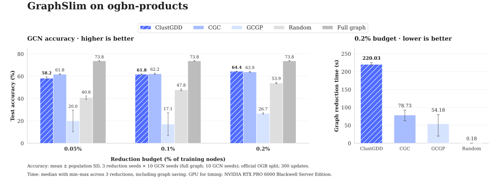
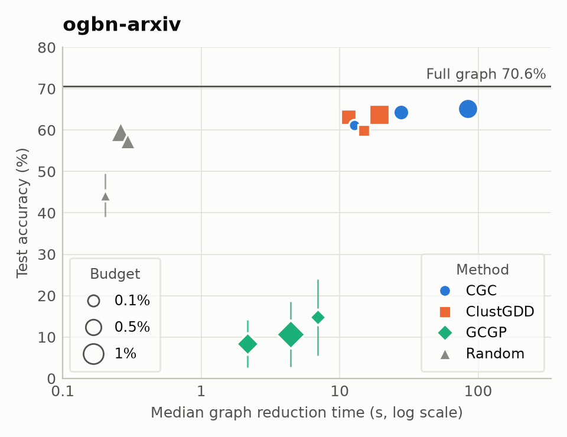
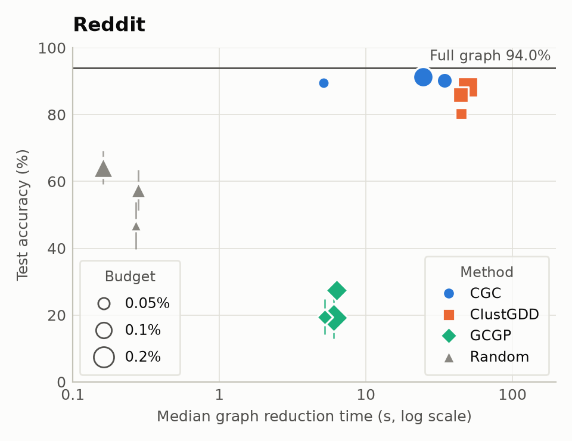
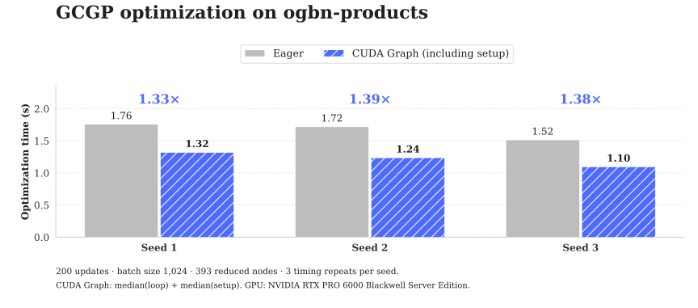

<div align="center">

# GraphSlim

[English](README.md) | **简体中文**

用于图稀疏化、图粗化和图凝聚的 PyTorch 库。

[文档](https://graphslim.readthedocs.io/en/latest/) ·
[GC4NC 基准论文](https://arxiv.org/abs/2406.16715) ·
[Web 界面](https://graphslim-vis.streamlit.app/) ·
[论文合集](https://github.com/Emory-Melody/awesome-graph-reduction)


</div>

GraphSlim 加载 PyG 图，通过统一的方法注册表执行图缩减，再使用统一的下游 GNN 流程评估缩减后的图。
本仓库包含软件包、可运行示例、回归测试和基准复现命令。

加速后端使用 PyTorch 原生算子和 CUDA Graph，面向 A100 及更新的 NVIDIA 显卡，
覆盖 Ampere、Ada、Hopper 和 Blackwell 架构。通过 `--cuda_graph` 启用。
[GPU 配置与检查](docs/compatibility.md#gpu-portability)。

## ogbn-products 实测结果

数据集包含 2,449,029 个节点，使用 OGB 官方划分。下图覆盖训练节点数的
0.05%、0.1% 和 0.2% 三个缩减比例，各缩减方法使用 3 个缩减种子 × 10 个 GCN 种子。
每次 GCN 训练执行 300 次更新。



准确率误差线为标准差；缩减耗时柱为三次运行的中位数，误差线为最小值至最大值。
[完整结果与实验设置](docs/products.md) ·
[逐种子结果与来源记录](benchmark/results/products_20261028.json)。

### 图缩减耗时与准确率的权衡

<p align="center">
  <picture>
    <source media="(prefers-color-scheme: dark)" srcset="./figures/tradeoff_ogbn-arxiv_dark.png">
    
  </picture>
  <picture>
    <source media="(prefers-color-scheme: dark)" srcset="./figures/tradeoff_reddit_dark.png">
    
  </picture>
</p>

每个标记代表一种方法在一个预算下的结果，标记大小表示预算占有标签训练节点的比例。
误差线为 3 个缩减种子 × 10 个 GCN 种子的标准差，水平线为原图准确率。
这些实验与 Products 结果使用相同的 GCN 流程、包内默认配置和 GPU。
Reddit 使用 PyG 的 Reddit2 图。NOPE 在两个数据集上均未能在一小时任务时限内完成，因此未列出。
[逐种子结果与来源记录](benchmark/results/tradeoff_20261028.json) ·
[实验协议](docs/dataset_expansion.md)。

<details>
<summary>绘图数值</summary>

<!-- tradeoff-table:start -->
| 数据集 | 方法 | 预算 | 缩减后节点数 | 测试准确率（%） | 图缩减耗时（s） |
| --- | --- | ---: | ---: | ---: | ---: |
| ogbn-arxiv | 原图 | — | 169,343 | 70.61 ± 0.07 | — |
| ogbn-arxiv | CGC | 0.1% | 90 | 61.24 ± 0.38 | 12.78 |
| ogbn-arxiv | CGC | 0.5% | 454 | 64.27 ± 0.31 | 27.63 |
| ogbn-arxiv | CGC | 1% | 909 | 65.19 ± 0.58 | 84.04 |
| ogbn-arxiv | ClustGDD | 0.1% | 90 | 59.87 ± 0.35 | 14.92 |
| ogbn-arxiv | ClustGDD | 0.5% | 454 | 63.13 ± 0.23 | 11.52 |
| ogbn-arxiv | ClustGDD | 1% | 909 | 63.76 ± 0.38 | 19.22 |
| ogbn-arxiv | GCGP | 0.1% | 91 | 14.75 ± 9.26 | 6.95 |
| ogbn-arxiv | GCGP | 0.5% | 455 | 8.42 ± 5.69 | 2.15 |
| ogbn-arxiv | GCGP | 1% | 909 | 10.63 ± 7.83 | 4.42 |
| ogbn-arxiv | Random | 0.1% | 89 | 44.22 ± 5.22 | 0.20 |
| ogbn-arxiv | Random | 0.5% | 439 | 57.26 ± 0.93 | 0.29 |
| ogbn-arxiv | Random | 1% | 892 | 59.68 ± 0.43 | 0.26 |
| Reddit | 原图 | — | 232,965 | 94.00 ± 0.03 | — |
| Reddit | CGC | 0.05% | 76 | 89.41 ± 0.09 | 5.12 |
| Reddit | CGC | 0.1% | 153 | 90.26 ± 0.12 | 34.40 |
| Reddit | CGC | 0.2% | 307 | 91.20 ± 0.19 | 24.64 |
| Reddit | ClustGDD | 0.05% | 76 | 80.21 ± 0.91 | 44.63 |
| Reddit | ClustGDD | 0.1% | 153 | 85.86 ± 0.69 | 44.41 |
| Reddit | ClustGDD | 0.2% | 307 | 88.33 ± 0.56 | 49.51 |
| Reddit | GCGP | 0.05% | 77 | 19.48 ± 5.28 | 5.22 |
| Reddit | GCGP | 0.1% | 154 | 27.47 ± 1.52 | 6.30 |
| Reddit | GCGP | 0.2% | 308 | 19.23 ± 6.23 | 6.02 |
| Reddit | Random | 0.05% | 69 | 46.81 ± 7.10 | 0.27 |
| Reddit | Random | 0.1% | 138 | 57.32 ± 6.08 | 0.28 |
| Reddit | Random | 0.2% | 288 | 64.19 ± 4.96 | 0.16 |
<!-- tradeoff-table:end -->

</details>

可用以下命令根据固定的结果记录重新绘图：

```bash
python -m benchmark.render_tradeoff
```

### GCGP 的 CUDA Graph 优化耗时

Products 上的 200 次优化更新，批量大小 1,024，缩减图 393 个节点。
CUDA Graph 耗时包含初始化，每个种子重复计时 3 次。



两种运行方式在每个种子下得到相同的优化结果和下游得分。
图中耗时实测于 RTX PRO 6000 Blackwell Server Edition。
[计时详情](docs/products.md#cuda-graph-timing) · [启用 CUDA Graph](docs/cuda_graph.md)。

`graphslim-doctor` 可检查 PyTorch、稀疏运算和可选的 DGL 安装。

```bash
python -m graphslim.doctor --device cuda:0 --dgl --json --output doctor.json
```

## 安装

请使用 Python 3.10 或 3.11。先安装适合 CPU/CUDA 环境的 PyTorch，再安装匹配的 PyG 扩展 wheel。
以下为 CPU 开发环境示例：

```bash
git clone https://github.com/Emory-Melody/GraphSlim.git
cd GraphSlim
uv venv --python 3.11
source .venv/bin/activate
uv pip install torch==2.6.0 torchvision==0.21.0 --index-url https://download.pytorch.org/whl/cpu
uv pip install torch-scatter torch-sparse --no-deps --no-index -f https://data.pyg.org/whl/torch-2.6.0+cpu.html
uv pip install -e ".[dev]" --constraint <(printf 'torch==2.6.0\ntorchvision==0.21.0\n')
```

使用 CUDA 时，请从 [PyTorch](https://pytorch.org/get-started/previous-versions/) 和
[PyG](https://data.pyg.org/whl/) 选择匹配的 PyTorch 与扩展 wheel。
安装其余依赖时，应继续约束已安装的 Torch 版本。
Yelp/Amazon 欺诈检测数据集需要安装 `.[dgl]`，GECC 的模糊聚类需要 `.[fuzzy]`，Web 界面需要 `.[viz]`。
扩展 wheel 安装步骤使用 `--no-deps`，因为 PyG wheel 目录不包含 SciPy；随后安装 GraphSlim 时会补齐依赖。

仓库中的 `uv.lock` 记录依赖解析结果，可由 `uv sync --locked` 读取；
`uv pip sync` 需要 requirements 文件，不能读取 `uv.lock`。
编译后的 PyG 扩展仍须与 Torch/CUDA 环境匹配。

如需使用已发布的软件包，可运行：`pip install graphslim`。

## 快速开始

在仓库根目录运行以下命令。数据默认存放在 `./data`；可通过 `--load_path` 和 `--save_path` 指定数据集与检查点路径。
`-G -1` 表示使用 CPU；非负 GPU 编号对应 `CUDA_VISIBLE_DEVICES` 中已可见设备的索引。

```bash
python -m graphslim.train_all -D cora -M clustering -G -1 --save_path ./checkpoints
python -m graphslim.train_all -D cora -M gcond -G 0 --save_path ./checkpoints
python -m graphslim.run_eval -D cora -M gcond -G 0 --save_path ./checkpoints
python -m graphslim.run_eval -D cora -W -G -1
python -m graphslim.train_all --help
```

安装后可使用命令：`graphslim-train`、`graphslim-eval`、`graphslim-doctor` 和 `graphslim-visualize`。
`--run_reduction N` 使用连续随机种子执行 N 次缩减；`--run_eval N` 控制下游评估重复次数。
`--run_reduction 0` 评估已保存的图，`-W` 评估完整图。
程序先加载方法 JSON 中的默认配置，再应用显式命令行参数覆盖。
对于提供聚合变体的方法，可通过 `--agg`（别名 `--aggpreprocess`）选择该变体。

### 示例

各示例使用相同流程，并加载所选方法的默认配置。

```bash
python -m examples.train_node_sparsification -G -1
python -m examples.train_coarsen -G -1
python -m examples.train_gcond -G -1
```

也可以从任意目录直接执行示例，例如 `python examples/train_gcond.py --help`。
导入示例模块不会启动训练。

### 软件包 API

```python
from graphslim.config import get_args
from graphslim.train_all import run

args = get_args(
    [
        "-D",
        "cora",
        "-M",
        "gcond",
        "-G",
        "-1",
        "--run_reduction",
        "1",
        "--save_path",
        "./checkpoints",
    ]
)
results = run(args)  # 每次缩减返回一组（均值，标准差）
```

自定义流程可使用 `graphslim.dataset.get_dataset`、`graphslim.reduction.create_reducer` 和
`graphslim.evaluation.Evaluator`。
各方法的公共类仍可直接导入，例如 `from graphslim.condensation import GCond`。

## 支持的方法

通过以下方式查看规范方法名：

```python
from graphslim.reduction import list_methods

print(list_methods("condensation"))
```

| 类别 | 规范方法名 |
| --- | --- |
| 节点/边稀疏化 | `random`, `kcenter`, `herding`, `cent_d`, `cent_p`, `random_edge`, `spanning_forest`, `g_spar`, `local_degree`, `rank_degree`, `scan`, `t_spanner` |
| 粗化/聚类 | `averaging`, `clustering`, `vng`, `variation_neighborhoods`, `variation_edges`, `variation_cliques`, `heavy_edge`, `algebraic_jc`, `affinity_gs`, `kron`, `nope` |
| 图凝聚 | `gcond`, `gcondx`, `doscond`, `doscondx`, `gcdm`, `gcdmx`, `sfgc`, `geom`, `msgc`, `sgdd`, `gcsntk`, `gdem`, `simgc`, `gecc`, `cgc`, `clustgdd`, `gcgp` |

各方法的参数设置见对应配置文件，其中包括 GECC 的演化图工作流。

CGC 和 NOPE 在缩减阶段无需训练 GNN。ClustGDD 使用线性预训练和细化；
GCGP 通过高斯过程优化缩减后的特征和目标值。
[方法介绍、来源与验证](docs/lightweight_methods.md)。

```bash
python -m examples.train_lightweight -D cora -M cgc -G -1 --save_path ./checkpoints
python -m graphslim.train_all -D cora -M gcgp -G -1 --save_path ./checkpoints
```

通过 `--config method_overrides.json` 设置方法专属选项；显式命令行选项优先。
可从 `graphslim.condensation` 导入 `CGC`、`ClustGDD`、`GCGP`，
从 `graphslim.coarsening` 导入 `NOPE`。

## 复现基准

运行器在规划任务时不导入 Torch；不指定 `--dry-run` 时会串行执行任务。
可先试运行，检查待执行的实验矩阵：

```bash
python -m benchmark.reproduce performance --dry-run
python -m benchmark.reproduce performance --datasets cora citeseer --methods clustering gcond --dry-run
python -m benchmark.reproduce performance --datasets cora --methods clustering --skip-whole -- -G -1
bash benchmark/scripts/performance.sh --dry-run
```

性能实验矩阵覆盖论文的全部七个数据集和表 9 中的全部 19 种方法，另外加入聚类及四种新的轻量方法扩展，
最后运行完整图基线。表中保留论文报告的内存不足（OOM）和缺失单元格；
重新运行也可能因资源限制或方法专属要求而失败。
GEOM/SFGC 的论文性能结果来自原作者实现，而本地专家轨迹缓冲区的默认配置有所不同，
因此仅运行本包的命令不足以证明已精确复现论文得分。

其他实验套件包括 `scalability`、`data_initialization`、`transferability`、`nas`、
`graph_property_preservation` 和 `robustness`。
[benchmark/scripts](benchmark/scripts) 中的 shell 脚本将参数转发给同一运行器，
并独立于调用者的当前目录解析仓库路径。迁移性、NAS 和图属性实验需要已保存的缩减图。
论文实验与命令的对应关系见 [benchmark/README.md](benchmark/README.md)。

### 缩减比例

命令行中的比例以**有标签训练节点数**为分母。
表 9 对直推式数据集使用原始完整图的节点百分比，对归纳式数据集使用训练图的节点百分比。
复现某一行结果时，请保持这一分母区别。

| 数据集 | 设置 | 命令行 `-R` 值 | 表 9 比例标签（%） |
| --- | --- | --- | --- |
| Citeseer | 直推式 | 0.1, 0.25, 0.5 | 0.36, 0.90, 1.80 |
| Cora | 直推式 | 0.1, 0.25, 0.5 | 0.50, 1.30, 2.60 |
| Pubmed | 直推式 | 0.05, 0.1, 0.5 | 0.02, 0.03, 0.15 |
| Arxiv (`ogbn-arxiv`) | 直推式 | 0.001, 0.005, 0.01 | 0.05, 0.25, 0.50 |
| Flickr | 归纳式 | 0.001, 0.005, 0.01 | 0.10, 0.50, 1.00 |
| Reddit | 归纳式 | 0.0005, 0.001, 0.002 | 0.05, 0.10, 0.20 |
| Yelp | 归纳式 | 0.0005, 0.001, 0.002 | 0.05, 0.10, 0.20 |

论文表 8 中的 Pubmed 百分比存在不一致；下方结果原样保留表 9 的比例标签。
命令行比例会转换为各类别的整数节点预算，因此论文中四舍五入后的百分比不一定等于实际达到的精确比例。

## 完整的论文性能结果

来源：[GC4NC，arXiv:2406.16715v3，表 9](https://arxiv.org/html/2406.16715v3#A1.T9)
（2025 年 11 月 9 日）。这些是**论文已发表的测量结果**，并非本次代码整理产生的结果。
表格包含全部七个数据集和各自三个缩减比例。数值及所报告的 `±` 不确定性均原样保留；
原文表注将这些不确定性称为标准误。为便于阅读，完整图基线在不同缩减比例下重复列出。

`OOM` 表示来源报告内存不足；`-` 表示未提供数值。
`NR` 表示方法已实现，但该来源未单独报告结果，涉及 Clustering、DosCondX、GCDM、SimGC 和 GECC。
特别地，不会将来源中的 GCDMX 数值赋给 GCDM。
VN 对应 `variation_neighborhoods`，TSpanner 对应 `t_spanner`。
方法目录中的其他稀疏化/粗化方法也没有表 9 中已发表的得分。

这些 `NR` 方法的本地补充测量见下方[包内结果覆盖表](#package-measurements-completing-published-nr-coverage)。
该表包含聚类及全部四种额外的凝聚方法，明确保留修复后 SimGC 的进度，且不改写论文结果 CSV。

[固定版本 CSV](benchmark/results/gc4nc_table9.csv) 和[来源记录](benchmark/results/provenance.json)
保留了表格的数据来源。可使用以下命令检查或生成英文 README 中的结果表：

```bash
python -m benchmark.render_results --check
python -m benchmark.render_results
```

<!-- benchmark-results:start -->
### Citeseer — 测试准确率（%）

| 类别 | 方法 | 0.36% | 0.90% | 1.80% |
| --- | --- | ---: | ---: | ---: |
| 核心集/稀疏化 | Cent-D | 42.86 ± 2.7 | 58.77 ± 0.5 | 62.89 ± 0.4 |
| 核心集/稀疏化 | Cent-P | 37.78 ± 1.3 | 52.83 ± 0.4 | 63.37 ± 0.4 |
| 核心集/稀疏化 | Random | 35.37 ± 2.8 | 50.71 ± 0.8 | 62.62 ± 0.6 |
| 核心集/稀疏化 | Herding | 43.73 ± 1.6 | 59.24 ± 0.4 | 66.66 ± 0.5 |
| 核心集/稀疏化 | K-Center | 41.43 ± 1.4 | 51.15 ± 1.1 | 59.04 ± 0.9 |
| 核心集/稀疏化 | TSpanner | 71.83 ± 0.3 | 71.62 ± 0.4 | 71.60 ± 0.4 |
| 粗化 | Averaging | 69.75 ± 0.6 | 69.59 ± 0.5 | 69.50 ± 0.6 |
| 粗化 | VN | 34.32 ± 5.9 | 40.14 ± 5.3 | 41.98 ± 7.0 |
| 粗化 | VNG | 66.14 ± 0.3 | 66.07 ± 0.4 | 65.34 ± 0.6 |
| 粗化 | Clustering | NR | NR | NR |
| 凝聚 | GEOM | 67.61 ± 0.7 | 70.70 ± 0.5 | 73.03 ± 0.3 |
| 凝聚 | SFGC | 66.27 ± 0.8 | 70.27 ± 0.7 | 72.36 ± 0.5 |
| 凝聚 | GCSNTK | 63.51 ± 1.9 | 62.91 ± 0.8 | 63.90 ± 3.4 |
| 凝聚 | GCDMX | 70.65 ± 0.5 | 71.27 ± 0.6 | 72.08 ± 0.2 |
| 凝聚 | GCondX | 67.79 ± 0.7 | 69.69 ± 0.5 | 68.38 ± 0.5 |
| 凝聚 | GCond | 70.05 ± 2.1 | 69.15 ± 1.2 | 69.35 ± 0.8 |
| 凝聚 | DosCond | 69.41 ± 0.8 | 70.83 ± 0.4 | 72.18 ± 0.6 |
| 凝聚 | MSGC | 60.24 ± 6.0 | 72.08 ± 0.7 | 72.21 ± 0.4 |
| 凝聚 | SGDD | 71.87 ± 0.6 | 70.52 ± 0.6 | 69.65 ± 1.7 |
| 凝聚 | GDEM | 67.88 ± 1.8 | 70.13 ± 1.1 | 71.74 ± 0.9 |
| 凝聚 | DosCondX | NR | NR | NR |
| 凝聚 | GCDM | NR | NR | NR |
| 凝聚 | SimGC | NR | NR | NR |
| 凝聚 | GECC | NR | NR | NR |
| 基线 | 完整图 | 72.6 | 72.6 | 72.6 |

### Cora — 测试准确率（%）

| 类别 | 方法 | 0.50% | 1.30% | 2.60% |
| --- | --- | ---: | ---: | ---: |
| 核心集/稀疏化 | Cent-D | 57.79 ± 1.7 | 66.45 ± 2.2 | 75.79 ± 0.7 |
| 核心集/稀疏化 | Cent-P | 58.44 ± 1.7 | 66.38 ± 1.7 | 75.64 ± 1.6 |
| 核心集/稀疏化 | Random | 35.14 ± 2.5 | 63.63 ± 1.3 | 72.24 ± 0.6 |
| 核心集/稀疏化 | Herding | 51.68 ± 2.1 | 68.99 ± 0.7 | 73.77 ± 0.9 |
| 核心集/稀疏化 | K-Center | 44.64 ± 4.4 | 63.28 ± 1.4 | 70.55 ± 1.4 |
| 核心集/稀疏化 | TSpanner | 79.79 ± 0.4 | 80.84 ± 0.3 | 80.41 ± 0.3 |
| 粗化 | Averaging | 75.94 ± 0.7 | 75.87 ± 0.6 | 75.76 ± 1.1 |
| 粗化 | VN | 24.62 ± 5.7 | 51.07 ± 5.8 | 56.75 ± 5.4 |
| 粗化 | VNG | 70.40 ± 0.6 | 74.48 ± 0.5 | 76.03 ± 0.4 |
| 粗化 | Clustering | NR | NR | NR |
| 凝聚 | GEOM | 78.14 ± 0.5 | 82.29 ± 0.6 | 82.82 ± 0.2 |
| 凝聚 | SFGC | 75.11 ± 2.2 | 79.55 ± 0.3 | 80.54 ± 0.5 |
| 凝聚 | GCSNTK | 71.58 ± 0.9 | 71.22 ± 2.6 | 73.34 ± 0.6 |
| 凝聚 | GCDMX | 79.21 ± 0.4 | 80.26 ± 0.3 | 80.68 ± 0.3 |
| 凝聚 | GCondX | 79.74 ± 0.5 | 78.67 ± 0.4 | 78.60 ± 0.3 |
| 凝聚 | GCond | 80.17 ± 0.8 | 80.81 ± 0.5 | 80.54 ± 0.7 |
| 凝聚 | DosCond | 80.65 ± 0.6 | 80.85 ± 0.4 | 81.15 ± 0.5 |
| 凝聚 | MSGC | 80.54 ± 0.3 | 80.98 ± 0.5 | 80.94 ± 0.4 |
| 凝聚 | SGDD | 80.15 ± 0.5 | 80.29 ± 0.8 | 81.04 ± 0.5 |
| 凝聚 | GDEM | 54.76 ± 4.5 | 72.87 ± 1.8 | 81.76 ± 0.5 |
| 凝聚 | DosCondX | NR | NR | NR |
| 凝聚 | GCDM | NR | NR | NR |
| 凝聚 | SimGC | NR | NR | NR |
| 凝聚 | GECC | NR | NR | NR |
| 基线 | 完整图 | 81.5 | 81.5 | 81.5 |

### Pubmed — 测试准确率（%）

| 类别 | 方法 | 0.02% | 0.03% | 0.15% |
| --- | --- | ---: | ---: | ---: |
| 核心集/稀疏化 | Cent-D | 56.16 ± 2.6 | 55.61 ± 1.6 | 71.95 ± 0.5 |
| 核心集/稀疏化 | Cent-P | 57.28 ± 1.2 | 62.50 ± 1.0 | 73.35 ± 0.4 |
| 核心集/稀疏化 | Random | 49.46 ± 1.6 | 56.10 ± 1.8 | 71.84 ± 0.7 |
| 核心集/稀疏化 | Herding | 62.91 ± 1.5 | 69.28 ± 1.6 | 75.53 ± 0.4 |
| 核心集/稀疏化 | K-Center | 79.18 ± 0.2 | 65.59 ± 2.4 | 74.00 ± 0.2 |
| 核心集/稀疏化 | TSpanner | 62.91 ± 1.5 | 79.39 ± 0.3 | 78.39 ± 0.2 |
| 粗化 | Averaging | 74.09 ± 0.6 | 75.60 ± 0.4 | 75.60 ± 0.4 |
| 粗化 | VN | 75.60 ± 0.4 | 74.09 ± 0.6 | 73.68 ± 1.6 |
| 粗化 | VNG | 75.60 ± 0.4 | 75.72 ± 0.3 | 77.53 ± 0.5 |
| 粗化 | Clustering | NR | NR | NR |
| 凝聚 | GEOM | 69.64 ± 1.4 | 76.21 ± 0.7 | 78.49 ± 0.2 |
| 凝聚 | SFGC | 67.61 ± 2.0 | 66.89 ± 3.3 | 67.61 ± 4.1 |
| 凝聚 | GCSNTK | 29.45 ± 10.9 | 68.37 ± 3.0 | 69.89 ± 2.2 |
| 凝聚 | GCDMX | 77.62 ± 0.2 | 76.63 ± 1.2 | 77.48 ± 0.5 |
| 凝聚 | GCondX | 72.03 ± 1.6 | 72.05 ± 1.6 | 71.97 ± 0.5 |
| 凝聚 | GCond | 77.36 ± 0.7 | 78.05 ± 0.3 | 76.46 ± 0.5 |
| 凝聚 | DosCond | 58.13 ± 2.2 | 52.70 ± 0.3 | 76.45 ± 0.1 |
| 凝聚 | MSGC | 75.25 ± 0.7 | 78.26 ± 0.3 | 78.20 ± 0.2 |
| 凝聚 | SGDD | 78.11 ± 0.3 | 78.07 ± 0.3 | 75.95 ± 0.3 |
| 凝聚 | GDEM | 77.52 ± 0.7 | 78.05 ± 1.3 | 78.76 ± 1.1 |
| 凝聚 | DosCondX | NR | NR | NR |
| 凝聚 | GCDM | NR | NR | NR |
| 凝聚 | SimGC | NR | NR | NR |
| 凝聚 | GECC | NR | NR | NR |
| 基线 | 完整图 | 78.6 | 78.6 | 78.6 |

### Arxiv — 测试准确率（%）

| 类别 | 方法 | 0.05% | 0.25% | 0.50% |
| --- | --- | ---: | ---: | ---: |
| 核心集/稀疏化 | Cent-D | 32.88 ± 2.7 | 48.85 ± 1.1 | 52.01 ± 0.5 |
| 核心集/稀疏化 | Cent-P | 36.48 ± 2.0 | 47.90 ± 0.9 | 55.65 ± 0.5 |
| 核心集/稀疏化 | Random | 50.39 ± 1.4 | 58.92 ± 0.8 | 60.19 ± 0.5 |
| 核心集/稀疏化 | Herding | 51.49 ± 0.7 | 58.00 ± 0.5 | 57.70 ± 0.2 |
| 核心集/稀疏化 | K-Center | 50.52 ± 0.5 | 55.28 ± 0.6 | 58.66 ± 0.4 |
| 核心集/稀疏化 | TSpanner | - | - | - |
| 粗化 | Averaging | 59.62 ± 0.4 | 59.96 ± 0.3 | 59.94 ± 0.3 |
| 粗化 | VN | OOM | OOM | OOM |
| 粗化 | VNG | 54.89 ± 0.3 | 59.66 ± 0.2 | 60.93 ± 0.2 |
| 粗化 | Clustering | NR | NR | NR |
| 凝聚 | GEOM | 64.91 ± 0.4 | 68.78 ± 0.1 | 69.59 ± 0.2 |
| 凝聚 | SFGC | 64.91 ± 0.5 | 66.58 ± 0.3 | 67.03 ± 0.5 |
| 凝聚 | GCSNTK | 58.21 ± 1.7 | 59.98 ± 1.7 | 54.73 ± 5.0 |
| 凝聚 | GCDMX | 60.04 ± 0.4 | 60.59 ± 0.4 | 60.71 ± 0.7 |
| 凝聚 | GCondX | 59.40 ± 0.5 | 62.46 ± 0.3 | 59.93 ± 0.5 |
| 凝聚 | GCond | 60.49 ± 0.4 | 63.88 ± 0.2 | 64.23 ± 0.2 |
| 凝聚 | DosCond | 55.70 ± 0.3 | 57.39 ± 0.2 | 61.06 ± 0.6 |
| 凝聚 | MSGC | 57.66 ± 0.4 | 64.85 ± 0.3 | 65.73 ± 0.2 |
| 凝聚 | SGDD | 58.50 ± 0.2 | 59.18 ± 0.2 | 63.76 ± 0.2 |
| 凝聚 | GDEM | - | - | - |
| 凝聚 | DosCondX | NR | NR | NR |
| 凝聚 | GCDM | NR | NR | NR |
| 凝聚 | SimGC | NR | NR | NR |
| 凝聚 | GECC | NR | NR | NR |
| 基线 | 完整图 | 71.4 | 71.4 | 71.4 |

### Flickr — 测试准确率（%）

| 类别 | 方法 | 0.10% | 0.50% | 1.00% |
| --- | --- | ---: | ---: | ---: |
| 核心集/稀疏化 | Cent-D | 40.70 ± 0.4 | 42.90 ± 0.3 | 42.62 ± 0.2 |
| 核心集/稀疏化 | Cent-P | 40.97 ± 0.9 | 44.06 ± 0.3 | 44.51 ± 0.3 |
| 核心集/稀疏化 | Random | 42.94 ± 0.3 | 44.54 ± 0.5 | 44.68 ± 0.6 |
| 核心集/稀疏化 | Herding | 42.80 ± 0.1 | 43.86 ± 0.5 | 45.12 ± 0.4 |
| 核心集/稀疏化 | K-Center | 43.01 ± 0.5 | 43.46 ± 0.8 | 43.53 ± 0.6 |
| 核心集/稀疏化 | TSpanner | - | - | - |
| 粗化 | Averaging | 37.93 ± 0.3 | 37.76 ± 0.4 | 37.66 ± 0.3 |
| 粗化 | VN | 32.77 ± 5.7 | 33.79 ± 5.2 | 34.39 ± 6.0 |
| 粗化 | VNG | 44.33 ± 0.3 | 43.30 ± 0.6 | 43.84 ± 0.8 |
| 粗化 | Clustering | NR | NR | NR |
| 凝聚 | GEOM | 47.15 ± 0.1 | 46.71 ± 0.2 | 46.13 ± 0.2 |
| 凝聚 | SFGC | 46.38 ± 0.2 | 46.38 ± 0.2 | 46.61 ± 0.1 |
| 凝聚 | GCSNTK | 41.85 ± 3.1 | 33.39 ± 6.0 | 31.12 ± 4.2 |
| 凝聚 | GCDMX | 43.75 ± 0.3 | 45.05 ± 0.3 | 45.88 ± 0.1 |
| 凝聚 | GCondX | 46.66 ± 0.1 | 46.69 ± 0.1 | 46.58 ± 0.1 |
| 凝聚 | GCond | 46.75 ± 0.1 | 47.01 ± 0.2 | 46.99 ± 0.1 |
| 凝聚 | DosCond | 45.87 ± 0.3 | 45.89 ± 0.3 | 45.81 ± 0.1 |
| 凝聚 | MSGC | 46.21 ± 0.1 | 46.77 ± 0.1 | 46.12 ± 0.2 |
| 凝聚 | SGDD | 46.69 ± 0.1 | 46.39 ± 0.2 | 46.24 ± 0.3 |
| 凝聚 | GDEM | - | - | - |
| 凝聚 | DosCondX | NR | NR | NR |
| 凝聚 | GCDM | NR | NR | NR |
| 凝聚 | SimGC | NR | NR | NR |
| 凝聚 | GECC | NR | NR | NR |
| 基线 | 完整图 | 47.4 | 47.4 | 47.4 |

### Reddit — 测试准确率（%）

| 类别 | 方法 | 0.05% | 0.10% | 0.20% |
| --- | --- | ---: | ---: | ---: |
| 核心集/稀疏化 | Cent-D | 40.00 ± 1.1 | 50.47 ± 1.4 | 55.31 ± 1.8 |
| 核心集/稀疏化 | Cent-P | 45.83 ± 1.7 | 51.22 ± 1.4 | 61.56 ± 0.2 |
| 核心集/稀疏化 | Random | 40.13 ± 0.9 | 55.73 ± 0.5 | 58.39 ± 2.3 |
| 核心集/稀疏化 | Herding | 46.88 ± 0.4 | 59.34 ± 0.7 | 73.46 ± 0.5 |
| 核心集/稀疏化 | K-Center | 40.24 ± 0.8 | 48.28 ± 0.7 | 56.81 ± 1.7 |
| 核心集/稀疏化 | TSpanner | - | - | - |
| 粗化 | Averaging | 88.23 ± 0.1 | 88.32 ± 0.1 | 88.33 ± 0.1 |
| 粗化 | VN | OOM | OOM | OOM |
| 粗化 | VNG | 69.96 ± 0.5 | 76.95 ± 0.2 | 81.52 ± 0.6 |
| 粗化 | Clustering | NR | NR | NR |
| 凝聚 | GEOM | 90.63 ± 0.2 | 91.33 ± 0.1 | 91.03 ± 0.3 |
| 凝聚 | SFGC | 90.18 ± 0.2 | 89.84 ± 0.3 | 90.71 ± 0.1 |
| 凝聚 | GCSNTK | OOM | OOM | OOM |
| 凝聚 | GCDMX | 87.28 ± 0.2 | 89.96 ± 0.1 | 89.08 ± 0.1 |
| 凝聚 | GCondX | 86.56 ± 0.2 | 88.25 ± 0.3 | 88.73 ± 0.2 |
| 凝聚 | GCond | 85.39 ± 0.2 | 89.82 ± 0.1 | 90.42 ± 0.1 |
| 凝聚 | DosCond | 86.56 ± 0.4 | 88.32 ± 0.2 | 88.84 ± 0.2 |
| 凝聚 | MSGC | 87.62 ± 0.1 | 88.15 ± 0.1 | 87.03 ± 0.1 |
| 凝聚 | SGDD | 87.37 ± 0.2 | 88.73 ± 0.3 | 90.65 ± 0.1 |
| 凝聚 | GDEM | - | - | - |
| 凝聚 | DosCondX | NR | NR | NR |
| 凝聚 | GCDM | NR | NR | NR |
| 凝聚 | SimGC | NR | NR | NR |
| 凝聚 | GECC | NR | NR | NR |
| 基线 | 完整图 | 94.4 | 94.4 | 94.4 |

### Yelp — 宏平均 F1（%）

| 类别 | 方法 | 0.05% | 0.10% | 0.20% |
| --- | --- | ---: | ---: | ---: |
| 核心集/稀疏化 | Cent-D | 48.67 ± 0.3 | 51.03 ± 0.1 | 46.08 ± 0.0 |
| 核心集/稀疏化 | Cent-P | 46.81 ± 0.1 | 46.08 ± 0.0 | 46.08 ± 0.0 |
| 核心集/稀疏化 | Random | 46.08 ± 0.0 | 46.28 ± 0.1 | 49.31 ± 0.4 |
| 核心集/稀疏化 | Herding | 46.08 ± 0.0 | 52.23 ± 0.3 | 47.49 ± 0.1 |
| 核心集/稀疏化 | K-Center | 46.07 ± 0.0 | 46.22 ± 0.0 | 46.85 ± 0.2 |
| 核心集/稀疏化 | TSpanner | - | - | - |
| 粗化 | Averaging | 55.04 ± 0.1 | 53.51 ± 0.8 | 54.42 ± 0.3 |
| 粗化 | VN | 51.52 ± 1.6 | 51.68 ± 1.0 | 52.63 ± 1.1 |
| 粗化 | VNG | 49.24 ± 0.1 | 47.33 ± 0.5 | 48.63 ± 0.4 |
| 粗化 | Clustering | NR | NR | NR |
| 凝聚 | GEOM | 52.80 ± 2.2 | 47.56 ± 0.2 | 49.48 ± 0.7 |
| 凝聚 | SFGC | 46.20 ± 0.1 | 47.96 ± 0.0 | 46.70 ± 0.1 |
| 凝聚 | GCSNTK | OOM | OOM | OOM |
| 凝聚 | GCDMX | 50.75 ± 0.4 | 52.49 ± 0.1 | 55.89 ± 0.2 |
| 凝聚 | GCondX | 52.44 ± 0.4 | 49.70 ± 1.5 | 48.77 ± 1.3 |
| 凝聚 | GCond | 52.30 ± 0.1 | 53.22 ± 0.1 | 51.76 ± 0.2 |
| 凝聚 | DosCond | 51.10 ± 0.3 | 52.54 ± 0.1 | 52.19 ± 0.5 |
| 凝聚 | MSGC | 52.94 ± 0.2 | 50.97 ± 0.8 | 51.35 ± 0.5 |
| 凝聚 | SGDD | 52.02 ± 0.2 | 54.13 ± 0.2 | 52.86 ± 0.1 |
| 凝聚 | GDEM | - | - | - |
| 凝聚 | DosCondX | NR | NR | NR |
| 凝聚 | GCDM | NR | NR | NR |
| 凝聚 | SimGC | NR | NR | NR |
| 凝聚 | GECC | NR | NR | NR |
| 基线 | 完整图 | 58.2 | 58.2 | 58.2 |
<!-- benchmark-results:end -->

<!-- local-nr-results:start -->

### 本地 NR 重跑（与论文表 9 分开列示）

进度：306/315 次缩减运行已完成；0 次失败；9 次需要补充配置。

每个数值单元格均要求完成全部 3 个缩减随机种子 × 10 次下游 GCN 训练，评估训练为 300 个 epoch，隐藏维度为 256，共 2 层。
数值为 30 个测试得分的均值 ± 总体标准差，以百分比表示（Yelp 使用宏平均 F1）。
合成图检查点和 GCN 权重仅依据验证集表现选择。不对未完成的单元格求平均或排名。

下方命令行比例以有标签训练节点数为分母，并非论文表中以完整图为分母的百分比。
数据集划分固定使用数据随机种子 1；缩减随机种子为 1、2、3。
各方法的训练 epoch 数与超参数来自本仓库的 JSON 配置。
GECC 使用已实现的静态模式（不含演化划分）；缺失的 Yelp 配置标记为 `CONFIG`，不作为得分。

这些结果来自本仓库的本地重跑，不是对论文实验的精确重放：Reddit 加载器使用更稀疏的 Reddit2 变体；
FraudYelp 使用仓库中由固定随机种子生成的、按类别进行的 80/10/10 划分。
确切输入见各次运行的数据集哈希、计数及解析后的配置。

| 数据集 | 命令行比例 | Clustering | DosCondX | GCDM | SimGC | GECC |
| --- | ---: | ---: | ---: | ---: | ---: | ---: |
| cora | 0.1 | 73.74 ± 0.65 | 78.98 ± 0.54 | 78.40 ± 1.01 | 71.31 ± 5.12 | 81.93 ± 0.73 |
| cora | 0.25 | 75.46 ± 0.71 | 78.38 ± 0.52 | 79.59 ± 0.62 | 68.58 ± 11.56 | 82.81 ± 0.22 |
| cora | 0.5 | 77.31 ± 0.43 | 79.25 ± 0.78 | 80.90 ± 0.45 | 75.01 ± 4.30 | 82.53 ± 0.41 |
| citeseer | 0.1 | 69.78 ± 0.48 | 70.45 ± 1.27 | 71.25 ± 0.94 | 24.16 ± 4.18 | 73.06 ± 0.31 |
| citeseer | 0.25 | 69.35 ± 0.30 | 70.06 ± 1.03 | 71.21 ± 0.80 | 22.95 ± 5.34 | 73.01 ± 0.31 |
| citeseer | 0.5 | 69.14 ± 0.24 | 70.86 ± 0.99 | 71.96 ± 0.57 | 29.00 ± 7.06 | 72.89 ± 0.27 |
| pubmed | 0.05 | 75.56 ± 0.40 | 72.53 ± 1.54 | 77.65 ± 0.31 | 43.37 ± 3.93 | 75.09 ± 0.19 |
| pubmed | 0.1 | 75.10 ± 0.75 | 71.26 ± 1.43 | 77.39 ± 1.44 | 39.82 ± 5.56 | 77.71 ± 0.23 |
| pubmed | 0.5 | 76.46 ± 0.47 | 71.84 ± 1.26 | 76.76 ± 0.58 | 37.76 ± 10.11 | 80.20 ± 0.40 |
| ogbn-arxiv | 0.001 | 60.84 ± 0.53 | 60.42 ± 0.59 | 59.97 ± 0.46 | 56.15 ± 2.03 | 61.38 ± 0.55 |
| ogbn-arxiv | 0.005 | 61.95 ± 0.20 | 62.21 ± 0.98 | 60.59 ± 0.42 | 60.32 ± 0.40 | 64.92 ± 0.26 |
| ogbn-arxiv | 0.01 | 63.13 ± 0.17 | 61.75 ± 0.54 | 60.67 ± 0.48 | 60.39 ± 0.39 | 66.38 ± 0.35 |
| flickr | 0.001 | 46.04 ± 0.25 | 46.63 ± 0.22 | 43.56 ± 1.06 | 45.93 ± 0.26 | 46.33 ± 0.25 |
| flickr | 0.005 | 46.27 ± 0.31 | 46.64 ± 0.19 | 45.07 ± 0.61 | 41.99 ± 2.29 | 45.88 ± 0.22 |
| flickr | 0.01 | 45.70 ± 0.26 | 46.62 ± 0.16 | 45.33 ± 0.65 | 42.76 ± 1.56 | 46.18 ± 0.24 |
| reddit | 0.0005 | 89.44 ± 0.11 | 54.07 ± 3.38 | 86.88 ± 0.37 | 61.77 ± 28.60 | 89.50 ± 0.09 |
| reddit | 0.001 | 90.03 ± 0.18 | 56.83 ± 1.50 | 88.48 ± 0.44 | 79.20 ± 10.17 | 90.89 ± 0.09 |
| reddit | 0.002 | 91.57 ± 0.06 | 58.02 ± 1.31 | 89.92 ± 0.12 | 81.13 ± 7.56 | 91.63 ± 0.11 |
| yelp | 0.0005 | 53.63 ± 0.36 | 51.15 ± 1.07 | 51.77 ± 1.47 | 49.26 ± 2.46 | CONFIG |
| yelp | 0.001 | 53.69 ± 0.19 | 51.09 ± 1.20 | 53.43 ± 1.75 | 49.78 ± 2.78 | CONFIG |
| yelp | 0.002 | 52.45 ± 0.22 | 50.53 ± 0.73 | 53.87 ± 0.55 | 52.51 ± 3.38 | CONFIG |

`PENDING (n/3)` 保留部分已完成的缩减进度，但不发布部分得分。
`FAILED`/`INTERRUPTED` 保留错误记录；`CONFIG` 表示需要补充方法配置。
机器可读得分、配置、数据集哈希、源码快照、检查点哈希和日志均位于运行目录。

<!-- local-nr-results:end -->

<!-- paper-hpo-results:start -->

### 基于论文设置的超参数优化（HPO；新本地批次，保留早期未调参结果）

任务：367/367 已完成；0 个运行中；0 个失败。

已完成的验证候选配置：GECC 4394/4394；SimGC 下游 GCN 756/756。

GECC–Yelp：穷举 4,394 种设置（13³ 组传播权重 × 2 种权重衰减），K=2，使用硬聚类 k-means++，重启一次。
SimGC：先修正原作者实现/设置，再使用 GC4NC 表 11 中含 108 种配置的下游 GCN 网格。
两者的搜索空间不同，不能互换。

搜索仅使用验证集指标、十个固定评估随机种子、300 个 epoch，
以及最高命令行缩减比例下、随机种子为 1 的缩减图。
每组必须完成全部候选配置后才能固定选择，并将该选择复用于全部三个比例。
每个最终单元格要求完成 3 个缩减随机种子 × 10 次 GCN 训练。
数值为测试均值 ± 总体标准差（%；Yelp 使用宏平均 F1）。

适用范围说明：GECC 未发表 Yelp 的最优配置；SimGC 未发表 Pubmed/Yelp 的最优配置（将原作者通用默认配置用于这些数据集属于扩展）。
Reddit 使用 Reddit2；FraudYelp 使用本地固定种子 1 的划分。
SimGC 的合成数据对齐梯度、教师模型传播顺序/归一化以及平滑项符号，已对照固定版本的原作者代码修复。
GECC 的归纳式传播深度和下游训练模式中的 dropout 已修复。
因此，本批次不能被解读为仅改变超参数的比较或对论文的精确重放。

来源：[GECC §5.1](https://arxiv.org/html/2502.17614#S5.SS1)、
[GC4NC 表 11](https://arxiv.org/html/2406.16715v3#A1.SS8.SSS2)、
[SimGC §5.1](https://arxiv.org/html/2403.14951#S5.SS1)、
[固定版本的 SimGC 代码](https://github.com/BangHonor/SimGC/tree/1b3d1d59d9afaf2c9c0c7b652fb183db2a5ffa01)。

| 数据集 | 命令行比例 | SimGC（原作者设置 + GCN HPO） | GECC（论文网格，Yelp 扩展） |
| --- | ---: | ---: | ---: |
| citeseer | 0.1 | 44.48 ± 13.99 | — |
| citeseer | 0.25 | 47.25 ± 13.15 | — |
| citeseer | 0.5 | 49.77 ± 9.35 | — |
| cora | 0.1 | 25.71 ± 7.39 | — |
| cora | 0.25 | 25.25 ± 6.32 | — |
| cora | 0.5 | 33.40 ± 5.08 | — |
| pubmed | 0.05 | 63.08 ± 14.26 | — |
| pubmed | 0.1 | 67.57 ± 8.54 | — |
| pubmed | 0.5 | 72.76 ± 2.32 | — |
| ogbn-arxiv | 0.001 | 60.85 ± 0.41 | — |
| ogbn-arxiv | 0.005 | 63.08 ± 0.42 | — |
| ogbn-arxiv | 0.01 | 63.05 ± 0.69 | — |
| flickr | 0.001 | 46.20 ± 0.32 | — |
| flickr | 0.005 | 46.24 ± 0.29 | — |
| flickr | 0.01 | 45.59 ± 1.37 | — |
| reddit | 0.0005 | 88.07 ± 0.47 | — |
| reddit | 0.001 | 89.01 ± 0.25 | — |
| reddit | 0.002 | 90.06 ± 0.23 | — |
| yelp | 0.0005 | 47.41 ± 1.55 | 47.71 ± 2.86 |
| yelp | 0.001 | 47.56 ± 1.52 | 50.69 ± 2.92 |
| yelp | 0.002 | 47.54 ± 1.77 | 53.94 ± 0.41 |

产物目录：`runs/paper_hpo_20261010_v2`（任务清单、固定版本源码、原始验证得分、配置选择、测试记录、检查点哈希和日志）。
`PENDING` 不是数值结果。

<!-- paper-hpo-results:end -->

### SimGC 引文网络实现修正（2026-10-10）

上方归档的 HPO 表生成于进一步修复 Cora/Citeseer 兼容性之前：
其中通用的 ReLU GCN 和 300 个 epoch 的预算，与原作者发布的引文网络评估分支不匹配。
表中 SimGC 的引文网络数值属于历史上的复现失败结果，不能作为该方法论文性能的证据。
旧表、源码快照和原始得分均保持不变。

当前包内默认设置支持 `activation=None`（或命令行 `--activation none`），
分别使用原作者隐藏维度为 2048 的图选择 GCN 和隐藏维度为 1024 的下游 GCN，
并保留 dropout/权重衰减为零、恒定 lr=0.001 以及发布版本的验证频率。
图选择执行 3,000 次更新；最终评估执行 3,001 次更新，与原作者包含终点的最终循环一致。
后续 HPO 保留 108 个 GC4NC 候选配置，并为 Cora/Citeseer 加入发布版本的基线。
命令及验证范围见 [SimGC 实验协议](docs/simgc.md)。

引文网络配置还使用原始特征（`pre_norm=false`），与原作者实际使用的 `dataset.data` 转换一致；
该转换会绕过附加的特征变换。
这里明确记录该方法特有的预处理差异；其他方法的加载器默认配置保持不变。
SimGC 按原作者实现对每类节点数向上取整，而不是使用通用的向下取整预算。

本修正说明不声称已获得修复后的测试集结果。仅使用验证集的集成检查与基准结果表分开列示。
在比例 0.5、缩减随机种子 1 / 下游随机种子 0 下，新进行的完整预算检查得到验证准确率：
[Cora 为 72.6%](runs/simgc_fix_cora_20261010_v2/result.json)，
[Citeseer 为 51.8%](runs/simgc_fix_citeseer_20261010_v2/result.json)。
两者均通过与固定版本原作者输入转换器及模型前向/梯度的一致性检查。
这些单种子验证得分不足以证明论文级复现，仍需新的多种子测试评估。

<!-- repaired-hpo-results:start -->

### 修复后的包内 HPO（新源码，保留历史批次）

任务：191/191 已完成；0 个运行中；0 个失败。

已完成的验证候选配置：GECC 0/0；SimGC 下游 GCN 758/758。

本批次没有新的 GECC 搜索；已完成的 GECC 结果保留在其历史来源批次中。
SimGC：每个数据集使用 108 个 GC4NC 下游 GCN 候选配置，并为 Cora/Citeseer 各加入发布版本基线（各 109 个）。

搜索仅使用验证集和十个固定评估随机种子；Cora/Citeseer 使用发布版本中无激活函数的 GCN 配置
（下游更新 3,001 次，每 100 次验证一次），其他数据集使用本地 300 个 epoch 的协议。
凝聚图选择单独进行（引文网络：隐藏维度 2048，更新 3,000 次）。整组搜索完成并固定选择后才进行测试。
最终单元格汇总 3 个缩减随机种子 × 10 次 GCN 训练，报告测试均值 ± 总体标准差（%；Yelp 使用宏平均 F1）。

适用范围说明：GECC 未发表 Yelp 的最优配置；SimGC 未发表 Pubmed/Yelp 的最优配置（将原作者通用默认配置用于这些数据集属于扩展）。
Reddit 使用 Reddit2；FraudYelp 使用本地固定种子 1 的划分。
SimGC 的合成数据对齐梯度、教师模型传播顺序/归一化以及平滑项符号，已对照固定版本的原作者代码修复。
GECC 的归纳式传播深度和下游训练模式中的 dropout 已修复。
因此，本批次不能被解读为仅改变超参数的比较或对论文的精确重放。
Cora/Citeseer 现使用发布版本实际采用的原始特征、独立的引文网络模型配置和 Glorot 初始化；
SimGC 使用每类向上取整的节点预算。
这些方法专属修复改变了科学实验协议，因此不能将不同来源批次视为同一受控实验进行排名。

来源：[GECC §5.1](https://arxiv.org/html/2502.17614#S5.SS1)、
[GC4NC 表 11](https://arxiv.org/html/2406.16715v3#A1.SS8.SSS2)、
[SimGC §5.1](https://arxiv.org/html/2403.14951#S5.SS1)、
[固定版本的 SimGC 代码](https://github.com/BangHonor/SimGC/tree/1b3d1d59d9afaf2c9c0c7b652fb183db2a5ffa01)。

| 数据集 | 命令行比例 | SimGC（原作者设置 + GCN HPO） | GECC（论文网格，Yelp 扩展） |
| --- | ---: | ---: | ---: |
| citeseer | 0.1 | 42.13 ± 5.38 | — |
| citeseer | 0.25 | 51.92 ± 8.36 | — |
| citeseer | 0.5 | 50.87 ± 4.53 | — |
| cora | 0.1 | 57.80 ± 16.33 | — |
| cora | 0.25 | 77.97 ± 2.72 | — |
| cora | 0.5 | 78.13 ± 2.32 | — |
| pubmed | 0.05 | 72.19 ± 2.35 | — |
| pubmed | 0.1 | 68.03 ± 6.62 | — |
| pubmed | 0.5 | 72.44 ± 1.96 | — |
| ogbn-arxiv | 0.001 | 61.41 ± 0.63 | — |
| ogbn-arxiv | 0.005 | 62.91 ± 0.99 | — |
| ogbn-arxiv | 0.01 | 62.61 ± 0.90 | — |
| flickr | 0.001 | 46.21 ± 0.32 | — |
| flickr | 0.005 | 46.26 ± 0.34 | — |
| flickr | 0.01 | 46.29 ± 0.36 | — |
| reddit | 0.0005 | 87.12 ± 0.66 | — |
| reddit | 0.001 | 89.11 ± 0.31 | — |
| reddit | 0.002 | 90.33 ± 0.11 | — |
| yelp | 0.0005 | 47.85 ± 1.34 | — |
| yelp | 0.001 | 47.67 ± 1.69 | — |
| yelp | 0.002 | 47.71 ± 1.62 | — |

产物目录：`/home/sgong36/gslim/runs/simgc_repaired_hpo_20261010`
（任务清单、固定版本源码、原始验证得分、配置选择、测试记录、检查点哈希和日志）。`PENDING` 不是数值结果。

<!-- repaired-hpo-results:end -->

<!-- package-results:start -->

<a id="package-measurements-completing-published-nr-coverage"></a>

## 补全论文 NR 覆盖的包内测量

完整的本地结果单元格：105/105（7 个数据集 × 3 个命令行比例 × 5 种方法）。
仅完成全部 3 个缩减随机种子 × 10 次下游测试训练的单元格才显示数值。
数值为测试均值 ± 总体标准差（%），不是论文表中报告的标准误。
Yelp 使用宏平均 F1；其余各行使用准确率。
尚未完成的修复后 SimGC 单元格不会回退使用已被替代的测量结果。

本表明确标注各单元格的来源，用于展示结果覆盖情况，而非受控排名：
NR 方法使用归档的固定 GCN 协议；GECC–Yelp 使用论文网格 HPO；
SimGC 使用新修复的源码及仅依赖验证集的 GCN HPO
（引文网络使用原始特征、无激活函数、3,001 次更新；其他数据集为 300 次更新）。
源码、预处理、训练预算和评估随机种子安排均存在差异。
论文结果与更早的本地批次在上方分别保留。

| 数据集 | 命令行比例 | Clustering | DosCondX | GCDM | SimGC（修复后 HPO） | GECC |
| --- | ---: | ---: | ---: | ---: | ---: | ---: |
| citeseer | 0.1 | 69.78 ± 0.48 | 70.45 ± 1.27 | 71.25 ± 0.94 | 42.13 ± 5.38 | 73.06 ± 0.31 |
| citeseer | 0.25 | 69.35 ± 0.30 | 70.06 ± 1.03 | 71.21 ± 0.80 | 51.92 ± 8.36 | 73.01 ± 0.31 |
| citeseer | 0.5 | 69.14 ± 0.24 | 70.86 ± 0.99 | 71.96 ± 0.57 | 50.87 ± 4.53 | 72.89 ± 0.27 |
| cora | 0.1 | 73.74 ± 0.65 | 78.98 ± 0.54 | 78.40 ± 1.01 | 57.80 ± 16.33 | 81.93 ± 0.73 |
| cora | 0.25 | 75.46 ± 0.71 | 78.38 ± 0.52 | 79.59 ± 0.62 | 77.97 ± 2.72 | 82.81 ± 0.22 |
| cora | 0.5 | 77.31 ± 0.43 | 79.25 ± 0.78 | 80.90 ± 0.45 | 78.13 ± 2.32 | 82.53 ± 0.41 |
| pubmed | 0.05 | 75.56 ± 0.40 | 72.53 ± 1.54 | 77.65 ± 0.31 | 72.19 ± 2.35 | 75.09 ± 0.19 |
| pubmed | 0.1 | 75.10 ± 0.75 | 71.26 ± 1.43 | 77.39 ± 1.44 | 68.03 ± 6.62 | 77.71 ± 0.23 |
| pubmed | 0.5 | 76.46 ± 0.47 | 71.84 ± 1.26 | 76.76 ± 0.58 | 72.44 ± 1.96 | 80.20 ± 0.40 |
| ogbn-arxiv | 0.001 | 60.84 ± 0.53 | 60.42 ± 0.59 | 59.97 ± 0.46 | 61.41 ± 0.63 | 61.38 ± 0.55 |
| ogbn-arxiv | 0.005 | 61.95 ± 0.20 | 62.21 ± 0.98 | 60.59 ± 0.42 | 62.91 ± 0.99 | 64.92 ± 0.26 |
| ogbn-arxiv | 0.01 | 63.13 ± 0.17 | 61.75 ± 0.54 | 60.67 ± 0.48 | 62.61 ± 0.90 | 66.38 ± 0.35 |
| flickr | 0.001 | 46.04 ± 0.25 | 46.63 ± 0.22 | 43.56 ± 1.06 | 46.21 ± 0.32 | 46.33 ± 0.25 |
| flickr | 0.005 | 46.27 ± 0.31 | 46.64 ± 0.19 | 45.07 ± 0.61 | 46.26 ± 0.34 | 45.88 ± 0.22 |
| flickr | 0.01 | 45.70 ± 0.26 | 46.62 ± 0.16 | 45.33 ± 0.65 | 46.29 ± 0.36 | 46.18 ± 0.24 |
| reddit | 0.0005 | 89.44 ± 0.11 | 54.07 ± 3.38 | 86.88 ± 0.37 | 87.12 ± 0.66 | 89.50 ± 0.09 |
| reddit | 0.001 | 90.03 ± 0.18 | 56.83 ± 1.50 | 88.48 ± 0.44 | 89.11 ± 0.31 | 90.89 ± 0.09 |
| reddit | 0.002 | 91.57 ± 0.06 | 58.02 ± 1.31 | 89.92 ± 0.12 | 90.33 ± 0.11 | 91.63 ± 0.11 |
| yelp | 0.0005 | 53.63 ± 0.36 | 51.15 ± 1.07 | 51.77 ± 1.47 | 47.85 ± 1.34 | 47.71 ± 2.86 |
| yelp | 0.001 | 53.69 ± 0.19 | 51.09 ± 1.20 | 53.43 ± 1.75 | 47.67 ± 1.69 | 50.69 ± 2.92 |
| yelp | 0.002 | 52.45 ± 0.22 | 50.53 ± 0.73 | 53.87 ± 0.55 | 47.71 ± 1.62 | 53.94 ± 0.41 |

来源对应关系（不跨批次汇总得分）：

- `clustering, doscondx, gcdm, gecc` 在 `citeseer, cora, pubmed, ogbn-arxiv, flickr, reddit, yelp` 上：`runs/nr_20261009_v2` — NR 批次，固定 GCN，300 次更新。
- `gecc` 在 `yelp` 上：`runs/paper_hpo_20261010_v2` — 已完成的 GECC Yelp 论文网格搜索。
- `simgc` 在 `citeseer, cora, pubmed, ogbn-arxiv, flickr, reddit, yelp` 上：`runs/simgc_repaired_hpo_20261010` — 修复后的 SimGC，重新执行缩减，并仅使用验证集搜索 GCN 配置。

[机器可读覆盖情况与逐单元格来源](benchmark/results/package_local_results.json)；
[CSV 导出](benchmark/results/package_local_results.csv)。
`PENDING`/`FAILED`/`CONFIG` 表示结果不可用，不代表零。
论文中的 `NR` 表示论文未报告，不表示本地覆盖表中没有结果。
原始产物位于所列运行目录中。

<!-- package-results:end -->

## 轻量方法：下游验证

[数据集扩展实验](docs/dataset_expansion.md) 在每个比例下使用 3 个缩减种子和 10 个 GCN 种子。
[Products 完整结果](docs/products.md) 包含 CGC、ClustGDD、GCGP 和 Random 的全部三个缩减比例。

方法测试覆盖七种下游架构、直推式与归纳式设置、噪声、缩减图重新加载和基于验证集的模型选择。
[方法配置与测试说明](docs/lightweight_methods.md)。

```bash
python -m benchmark.lightweight_downstream --run-dir runs/lightweight_cora --dry-run
python -m benchmark.lightweight_downstream --run-dir runs/lightweight_cora --profile smoke
python -m benchmark.reproduce robustness --datasets cora --methods cgc clustgdd gcgp nope --dry-run
```

<!-- lightweight-checks:start -->

Cora 短流程测试使用 20 步缩减和下游训练、32 维隐藏层，以及一个缩减/评估种子。
[测试结果 CSV](benchmark/results/lightweight_integration.csv) ·
[设置与核验记录 JSON](benchmark/results/lightweight_integration.json)。

<!-- lightweight-checks:end -->

## 开发与测试

```bash
python -m pytest -q
ruff check graphslim examples benchmark tests interface
ruff format --check graphslim examples benchmark tests interface
python -m build
```

回归测试使用小型内存图、CPU GNN 训练和模拟任务调度。
基准实验使用原始数据集、各方法的参数设置和重复评估。[历史开发测试](efficiency.md)。

## 仓库结构

```text
graphslim/       软件包、方法、加载器、模型、评估与命令行接口
examples/        使用包内流程的小型入口示例
tests/           回归测试
benchmark/       复现规划器、研究脚本与论文结果
docs/            Sphinx 文档
interface/       Streamlit 应用与示例产物
```

## Web 界面

```bash
pip install -e ".[viz]"
python -m streamlit run interface/vis_graphslim.py
```

## 引用与致谢

```bibtex
@inproceedings{gong2025gcnc,
  title={{GC}4{NC}: A Benchmark Framework for Graph Condensation on Node Classification with New Insights},
  author={Shengbo Gong and Juntong Ni and Noveen Sachdeva and Carl Yang and Wei Jin},
  booktitle={The Thirty-ninth Annual Conference on Neural Information Processing Systems Datasets and Benchmarks Track},
  year={2025}
}
@inproceedings{hashemi2024comprehensive,
  title={A comprehensive survey on graph reduction: sparsification, coarsening, and condensation},
  author={Hashemi, Mohammad and Gong, Shengbo and Ni, Juntong and Fan, Wenqi and Prakash, B Aditya and Jin, Wei},
  booktitle={Proceedings of the Thirty-Third International Joint Conference on Artificial Intelligence},
  pages={8058--8066},
  year={2024}
}
```

本项目的实现基于 [SCAL](https://github.com/szzhang17/Scaling-Up-Graph-Neural-Networks-Via-Graph-Coarsening)、
[graph sparsification](https://github.com/yuhanchan/sparsification)、
[GCond](https://github.com/ChandlerBang/GCond)、
[GCSNTK](https://github.com/WANGLin0126/GCSNTK)、
[SFGC](https://github.com/Amanda-Zheng/SFGC)、
[GEOM](https://github.com/NUS-HPC-AI-Lab/GEOM) 和
[DeepRobust](https://github.com/DSE-MSU/DeepRobust)。许可证见 [LICENSE](LICENSE)。
