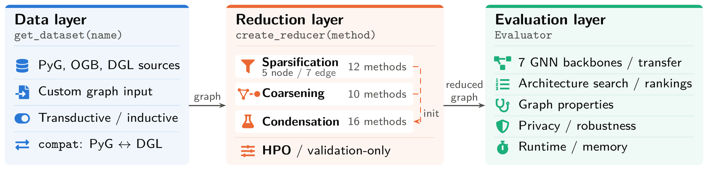
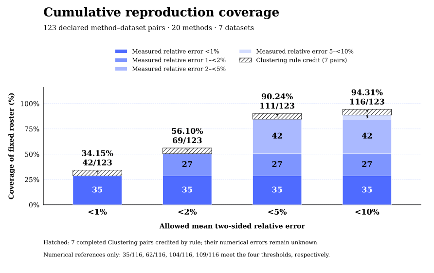
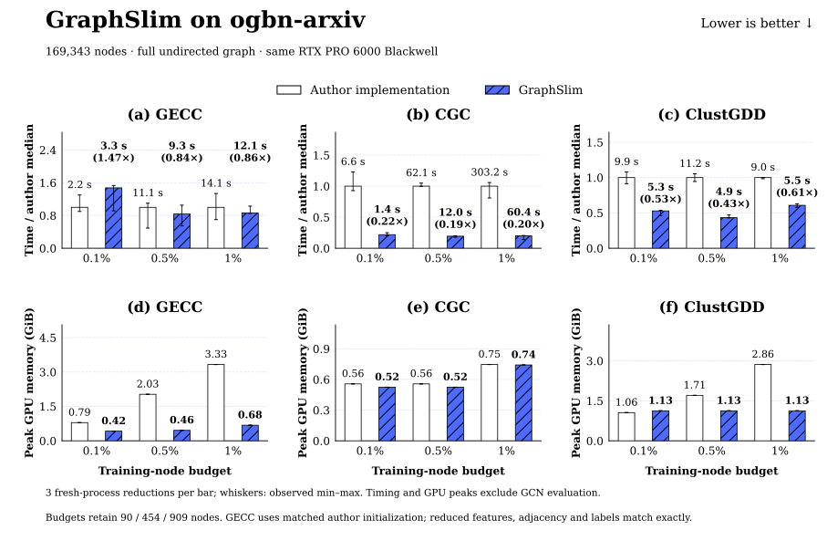

<div align="center">

# GraphSlim

[English](README.md) | **简体中文**

用于图稀疏化、图粗化和图凝聚的 PyTorch 库。

[文档](https://graphslim.readthedocs.io/en/latest/) ·
[GC4NC 基准论文](https://arxiv.org/abs/2406.16715) ·
[Web 界面](https://graphslim-vis.streamlit.app/) ·
[论文合集](https://github.com/Emory-Melody/awesome-graph-reduction)


</div>

GraphSlim 将 **49 种图缩减方法**、**7 种下游 GNN 骨干网络**和
**仅使用验证集选参的超参数优化（HPO）** 整合到统一流程中。
加载图、选择缩减方法、评估缩减图均使用共享接口。
本仓库包含可运行示例、回归测试和基准复现命令。

49 种方法包括 **5 种节点稀疏化、18 种边稀疏化、10 种粗化和 16 种凝聚方法**。
其中节点与边稀疏化合计 23 种；别名不重复计数。

GPU 运算使用 PyTorch 原生算子。请安装与显卡和 CUDA 运行时匹配的
Torch 与 PyG 扩展 wheel。
[GPU 配置与检查](README_zh-CN.md#gpu-setup-and-checks)。

[快速开始](#快速开始) · [软件框架](#软件框架) ·
[复现覆盖率](#复现覆盖率) · [聚类加速](#聚类加速) ·
[HPO](#超参数优化hpo) · [支持的方法](#支持的方法)

## 软件框架

[](figures/figure1.pdf)

Figure 1 展示软件包论文中包含 49 种方法的开发版框架。数据、缩减和评估三层均可独立调用。
中间的缩减层包含稀疏化、粗化、凝聚及可选 HPO；
实线表示图数据流，虚线表示使用节点选取或粗化结果初始化凝聚。
[矢量 PDF](figures/figure1.pdf) · [可编辑源文件](figures/figure1_architecture.tex)。

## 复现覆盖率

**固定的 123/123 个“方法×数据集”组合均已完成全部声明压缩率。**
**111/123（90.24%）** 的平均双边相对误差低于 5%；
**116/123（94.31%）** 的平均双边相对误差低于 10%。
该固定范围涉及 **20 种方法、7 个数据集**，每个方法与数据集组合等权。
各档达标数均包含按既定规则计入的 7 个 Clustering 组合，说明见下文。

<!-- reproduction-coverage:start -->

[](figures/reproduction_coverage.pdf)

各柱按阈值累计同一固定范围内的组合，蓝色区间对应互斥的实测误差范围。纹理部分为每档均按规则计入的同样 **7 个 Clustering 组合**，其数值差距仍未知。

[矢量 PDF](figures/reproduction_coverage.pdf) · [高清 PNG](figures/reproduction_coverage.png) · [经核对的绘图数据](benchmark/results/reproduction_coverage_figure.json) · [绘图脚本](benchmark/plot_reproduction_coverage.py)

| 判定口径 | <1% | <2% | <5% | <10% |
| --- | ---: | ---: | ---: | ---: |
| 双边相对误差 | 42/123 (34.15%) | 69/123 (56.10%) | 111/123 (90.24%) | 116/123 (94.31%) |

<!-- reproduction-coverage:end -->

双边相对误差为 `100 * abs(复现值 - 参照值) / abs(参照值)`，高于和低于参照值的偏差均计入。
先在每个声明且匹配的压缩率上计算，再在方法与数据集组合内平均，最后按严格 `<` 判断。
图中展示 1%、2%、5%、10% 四档相对容差，并非百分点差。

7 个 Clustering 组合已跑完，但没有论文数值参照，按既定报告规则计入各档达标数；实测差距仍为空。
仅统计 **116 个有数值参照的组合**时，双边误差低于 5% 的比例为 **104/116（89.66%）**，低于 10% 的比例为 **109/116（93.97%）**。

<details>
<summary>统计范围、参照修正与冻结证据</summary>

- 快照时间：**2026-11-01 22:52 UTC**。统计合并冻结的历史运行、按代码来源对齐的重放和验证集选参的 HPO，
  逐组合保留采用的评估版本。GEOM/SFGC 的论文引用值、完整图基线及无参照的额外单元格不在分母内。
- 参照来自 GC4NC 及 GECC、CGC、ClustGDD 各自论文。既定 Pubmed 修正采用正文 Table 1 的
  K-Center 和 Averaging 值；TSpanner 使用明确标记为推断的 Table 9 单元格交换。原值与修正值均保留在快照中。
- 此处覆盖率针对既定的方法与数据集子集。Figure 1 展示软件接口，各应用有各自的验证范围。
  本累计统计与下方结果表保留各自的来源版本和展示条件。
- [冻结汇总、逐组合指标、计入规则、参照修正及来源哈希](benchmark/results/reproduction_coverage_20261101.json)。
  执行 `python -m benchmark.render_readme_highlights --check` 可核对 README 表格。

</details>

## 聚类加速

[共享聚类算子](graphslim/reduction/cluster_ops.py)复用已拟合的聚类分配，
并优化稀疏聚合与分组聚合。

<!-- implementation-comparison:start -->

在**完整 ogbn-arxiv（169,343 个节点，对称化后存储 2,315,598 条边）**上测量完整缩减流程。三种方法使用相同的冻结输入、官方划分、同一张 RTX PRO 6000 Blackwell GPU 和 4 个 CPU 线程。GraphSlim / 作者实现缩减耗时比：**GECC 0.84–1.47×**, **CGC 0.19–0.22×**, **ClustGDD 0.43–0.61×**，**越低越好**。

[](figures/clustering_arxiv_comparison.pdf)

[矢量 PDF](figures/clustering_arxiv_comparison.pdf) · [高清 PNG](figures/clustering_arxiv_comparison.png) · [经核对的绘图数据](benchmark/results/clustering_arxiv_figure.json)

三列依次为 GECC、CGC、ClustGDD。**上排：耗时 / 同组作者实现中位数（作者为 1），标注实测秒数；下排：峰值已分配 GPU 显存（GiB）。两项均越低越好。**每根柱为 3 个独立进程缩减的中位数，误差线为实测最小值至最大值，包含全部 **54 次缩减、9 个方法×预算组合**。0.1%、0.5%、1% 均以 **90,941 个有标签训练节点**为分母，分别保留 90、454、909 个节点。GECC 为另行冻结的补测批次，图中保留耗时更长的结果。

<details>
<summary>实测口径与冻结源码</summary>

- 从共同的标准化 CPU 图开始计时，包含缩减器构造、内部预处理和设备传输，起止同步 CUDA；不含导入、共同输入准备、保存和 GCN 评估。GPU 峰值在预热后、输入传入 GPU 前重置。
- 种子 1–3 交替执行两种实现。GECC 与既有 CGC/ClustGDD 批次的输入张量及 GPU UUID 一致，使用 4 个 CPU 线程并关闭 TF32。
- GECC：完整直推式传播，深度 2，权重 (0.6, 0.5, 0)，硬聚类，单次初始化，最多 300 轮。双方均采用作者的均匀随机中心初始化；此处不测量 GraphSlim 原生初始化。全部 9 个预算×种子组合的缩减特征、邻接和标签逐元素一致。作者的稠密诊断分配与 GraphSlim 的稀疏诊断分配均计入缩减显存。
- CGC：双方均为 10 次初始化、最多 300 轮，保留 FAISS/sklearn 各自收敛规则，重构采用 Float64。ClustGDD：双方均为 600 轮预训练、100 轮优化、3 次 MiniBatchKMeans 初始化。
- 计时之外，每个缩减图训练一次 300 轮 GCN，按验证集选择检查点。**9/9** 个方法×预算组合的实现间准确率均值双边相对差距低于 5%。参照为固定作者版本，与论文数值参照的复现覆盖率各有独立统计范围。
- [CGC/ClustGDD 原始记录](benchmark/results/arxiv_clustering_comparison_20261101.json) · [实测源码归档](benchmark/results/arxiv_clustering_source_20261101.zip)。
- [GECC 原始记录及作者固定版本](benchmark/results/gecc_arxiv_comparison_20261102.json) · [实测源码归档](benchmark/results/gecc_arxiv_source_20261102.zip) · [运行器](benchmark/compare_gecc_arxiv.py)。在 runs/reference/GECC 准备固定作者版本；共同运行环境使用 faiss-cpu==1.8.0.post1 与 NumPy 1.x。
- 执行 `python -m benchmark.plot_clustering_arxiv` 重新生成，加 `--check` 核验全部原始记录和图文件哈希。
- 历史合成张量算子记录单独保留：[CPU](benchmark/results/gecc_operator_cpu_20261029.json)、[CUDA](benchmark/results/gecc_operator_gpu_20261029.json)，其算子耗时不进入此图。
</details>

<!-- implementation-comparison:end -->

## 复现结果

下表用本软件包重新运行 [GC4NC 基准](https://arxiv.org/html/2406.16715v3#A1.T9)。
每个缩减图上训练两层、256 个隐藏单元的 GCN，每次 300 轮，共 10 次；缩减图按验证集准确率选取。
与论文一致，Random、K-Center 和 Herding 使用三个缩减种子，其余方法使用一个。
单元格为测试准确率（%）的均值 ± 标准差，Yelp 为宏平均 F1。
比例沿用表 9：Citeseer、Cora、Pubmed 和 Arxiv 为占完整图节点的百分比，
Flickr、Reddit 和 Yelp 为占训练图节点的百分比。

与论文数值平均相差不超过 3 个百分点的行才会列出。
GECC、CGC 和 ClustGDD 与各自论文报告的比例进行比较。
[冻结的结果与来源](benchmark/results/table9_reproduction.json)。

<details>
<summary>展开七个数据集的结果表与未列出行说明</summary>

<!-- reproduction-results:start -->

#### Citeseer — 测试准确率（%）

| 类别 | 方法 | 0.36% | 0.90% | 1.80% |
| --- | --- | ---: | ---: | ---: |
| 节点稀疏化 | Cent-D | 44.56 ± 2.30 | 59.32 ± 0.24 | 62.91 ± 0.47 |
| 节点稀疏化 | Cent-P | 41.04 ± 1.55 | 52.01 ± 0.78 | 65.42 ± 0.36 |
| 节点稀疏化 | Random | 36.94 ± 4.89 | 51.01 ± 4.46 | 63.13 ± 2.72 |
| 节点稀疏化 | Herding | 46.11 ± 2.80 | 61.67 ± 1.43 | 67.37 ± 1.37 |
| 节点稀疏化 | K-Center | 44.92 ± 4.69 | 53.58 ± 2.70 | 60.16 ± 1.28 |
| 边稀疏化 | TSpanner | 71.19 ± 0.44 | 71.57 ± 0.43 | 71.92 ± 0.26 |
| 粗化 | Averaging | 69.68 ± 0.43 | 69.70 ± 0.45 | 69.63 ± 0.41 |
| 粗化 | VNG | 68.83 ± 0.27 | 63.75 ± 0.46 | 67.55 ± 0.55 |
| 凝聚 | GEOM² | 67.61 ± 0.7 | 70.70 ± 0.5 | 73.03 ± 0.3 |
| 凝聚 | SFGC² | 66.27 ± 0.8 | 70.27 ± 0.7 | 72.36 ± 0.5 |
| 凝聚 | GCDMX | 69.91 ± 0.64 | 70.89 ± 0.38 | 71.82 ± 0.63 |
| 凝聚 | DosCondX¹ | 68.64 ± 0.47 | 69.24 ± 0.79 | 70.64 ± 0.82 |
| 凝聚 | GCond | 73.42 ± 0.32 | 70.80 ± 0.38 | 72.44 ± 0.42 |
| 凝聚 | DosCond | 70.29 ± 0.71 | 71.27 ± 0.42 | 71.64 ± 1.01 |
| 凝聚 | SGDD | 72.39 ± 0.83 | 71.21 ± 0.38 | 71.59 ± 0.50 |
| 凝聚 | GECC | 73.07 ± 0.33 | 72.82 ± 0.30 | 72.97 ± 0.22 |
| 凝聚 | CGC | 70.90 ± 0.24 | 71.89 ± 0.25 | 70.96 ± 0.11 |
| 凝聚 | ClustGDD | 71.92 ± 0.16 | 73.09 ± 0.27 | 72.54 ± 0.30 |

全图训练: 71.84 ± 0.21.

#### Cora — 测试准确率（%）

| 类别 | 方法 | 0.50% | 1.30% | 2.60% |
| --- | --- | ---: | ---: | ---: |
| 节点稀疏化 | Cent-D | 57.27 ± 1.15 | 66.86 ± 0.65 | 75.60 ± 0.42 |
| 节点稀疏化 | K-Center | 48.58 ± 5.61 | 64.46 ± 1.47 | 73.17 ± 0.72 |
| 边稀疏化 | TSpanner | 81.54 ± 0.21 | 80.62 ± 0.37 | 80.70 ± 0.25 |
| 粗化 | Averaging | 75.83 ± 0.70 | 75.83 ± 0.70 | 75.83 ± 0.70 |
| 粗化 | VNG | 64.59 ± 0.56 | 74.29 ± 0.45 | 75.32 ± 0.21 |
| 凝聚 | GEOM² | 78.14 ± 0.5 | 82.29 ± 0.6 | 82.82 ± 0.2 |
| 凝聚 | SFGC² | 75.11 ± 2.2 | 79.55 ± 0.3 | 80.54 ± 0.5 |
| 凝聚 | GCSNTK | 70.81 ± 1.62 | 68.33 ± 4.01 | 68.83 ± 1.65 |
| 凝聚 | GCDMX | 80.47 ± 0.46 | 80.59 ± 0.46 | 81.18 ± 0.24 |
| 凝聚 | DosCondX¹ | 80.51 ± 0.33 | 80.22 ± 0.43 | 78.51 ± 0.45 |
| 凝聚 | GCond | 80.34 ± 0.34 | 80.93 ± 0.58 | 81.15 ± 0.52 |
| 凝聚 | DosCond | 79.12 ± 0.70 | 79.96 ± 0.84 | 78.99 ± 0.96 |
| 凝聚 | MSGC | 79.78 ± 0.45 | 80.39 ± 0.58 | 80.89 ± 0.48 |
| 凝聚 | SGDD | 80.41 ± 0.49 | 81.00 ± 0.52 | 79.64 ± 0.60 |
| 凝聚 | GDEM | 53.60 ± 5.81 | 72.23 ± 2.19 | 75.94 ± 0.74 |
| 凝聚 | GECC | 81.94 ± 0.59 | 82.86 ± 0.35 | 82.61 ± 0.34 |
| 凝聚 | CGC | 79.75 ± 0.56 | 81.32 ± 0.37 | 80.75 ± 0.60 |

全图训练: 80.81 ± 0.51.

#### Pubmed — 测试准确率（%）

| 类别 | 方法 | 0.02% | 0.03% | 0.15% |
| --- | --- | ---: | ---: | ---: |
| 节点稀疏化 | Cent-D | 56.17 ± 2.57 | 55.61 ± 1.55 | 71.75 ± 0.82 |
| 节点稀疏化 | Cent-P | 56.17 ± 2.57 | 62.50 ± 0.99 | 72.48 ± 0.75 |
| 节点稀疏化 | Random | 51.17 ± 3.25 | 57.72 ± 2.02 | 74.08 ± 1.81 |
| 节点稀疏化 | Herding | 63.03 ± 1.61 | 68.99 ± 1.67 | 75.69 ± 0.63 |
| 粗化 | Averaging | 75.60 ± 0.42 | 75.60 ± 0.42 | 75.60 ± 0.42 |
| 粗化 | VNG | 72.85 ± 0.55 | 75.52 ± 0.38 | 76.25 ± 0.42 |
| 凝聚 | GEOM² | 69.64 ± 1.4 | 76.21 ± 0.7 | 78.49 ± 0.2 |
| 凝聚 | SFGC² | 67.61 ± 2.0 | 66.89 ± 3.3 | 67.61 ± 4.1 |
| 凝聚 | GCDMX | 77.60 ± 0.30 | 75.74 ± 1.37 | 77.44 ± 0.36 |
| 凝聚 | DosCondX¹ | 72.03 ± 1.58 | 72.25 ± 0.97 | 72.56 ± 0.29 |
| 凝聚 | GCond | 77.70 ± 0.64 | 78.09 ± 0.47 | 77.32 ± 0.43 |
| 凝聚 | DosCond | 58.03 ± 1.97 | 52.97 ± 0.17 | 76.87 ± 0.20 |
| 凝聚 | MSGC | 75.36 ± 0.58 | 77.99 ± 0.44 | 78.32 ± 0.25 |
| 凝聚 | SGDD | 78.16 ± 0.31 | 77.98 ± 0.32 | 76.25 ± 0.21 |
| 凝聚 | GECC | 75.14 ± 0.22 | 77.75 ± 0.23 | 80.54 ± 0.29 |

全图训练: 78.60 ± 0.57.

#### Arxiv — 测试准确率（%）

| 类别 | 方法 | 0.05% | 0.25% | 0.50% |
| --- | --- | ---: | ---: | ---: |
| 节点稀疏化 | Cent-D | 40.07 ± 1.51 | 49.09 ± 1.03 | 52.10 ± 0.49 |
| 节点稀疏化 | Cent-P | 34.45 ± 1.34 | 48.52 ± 0.88 | 57.40 ± 0.63 |
| 节点稀疏化 | Random | 44.91 ± 5.23 | 57.63 ± 1.14 | 59.74 ± 0.39 |
| 节点稀疏化 | Herding | 49.25 ± 1.86 | 57.26 ± 0.92 | 57.54 ± 0.72 |
| 节点稀疏化 | K-Center | 48.66 ± 1.70 | 55.40 ± 1.63 | 59.00 ± 0.55 |
| 边稀疏化 | TSpanner³ | 69.35 ± 0.39 | 69.44 ± 0.41 | 69.30 ± 0.28 |
| 粗化 | Averaging | 59.62 ± 0.42 | 59.96 ± 0.33 | 59.94 ± 0.30 |
| 凝聚 | GEOM² | 64.91 ± 0.4 | 68.78 ± 0.1 | 69.59 ± 0.2 |
| 凝聚 | SFGC² | 64.91 ± 0.5 | 66.58 ± 0.3 | 67.03 ± 0.5 |
| 凝聚 | GCDMX | 60.02 ± 0.44 | 60.59 ± 0.44 | 60.72 ± 0.64 |
| 凝聚 | DosCondX¹ | 59.58 ± 0.48 | 62.28 ± 0.39 | 59.73 ± 0.30 |
| 凝聚 | DosCond | 56.03 ± 0.60 | 57.41 ± 0.48 | 54.00 ± 0.58 |
| 凝聚 | MSGC | 61.09 ± 0.32 | 65.68 ± 0.23 | 64.85 ± 0.21 |
| 凝聚 | GDEM³ | 56.25 ± 1.21 | 61.41 ± 0.48 | 63.68 ± 0.40 |
| 凝聚 | GECC | 61.52 ± 0.22 | 64.95 ± 0.19 | 66.44 ± 0.19 |
| 凝聚 | CGC | 60.71 ± 0.61 | 63.52 ± 0.28 | 64.65 ± 0.28 |
| 凝聚 | ClustGDD | 62.11 ± 0.09 | 65.32 ± 0.08 | 66.38 ± 0.12 |

全图训练: 70.70 ± 0.14.

#### Flickr — 测试准确率（%）

| 类别 | 方法 | 0.10% | 0.50% | 1.00% |
| --- | --- | ---: | ---: | ---: |
| 节点稀疏化 | Cent-D | 40.69 ± 0.39 | 42.88 ± 0.29 | 42.63 ± 0.23 |
| 节点稀疏化 | Cent-P | 39.82 ± 1.34 | 41.77 ± 0.53 | 42.14 ± 0.35 |
| 节点稀疏化 | Random | 41.22 ± 1.91 | 43.89 ± 0.45 | 44.04 ± 0.68 |
| 节点稀疏化 | Herding | 40.05 ± 1.49 | 42.63 ± 0.95 | 44.44 ± 0.45 |
| 节点稀疏化 | K-Center | 39.88 ± 2.36 | 42.35 ± 1.10 | 43.02 ± 0.69 |
| 边稀疏化 | TSpanner³ | 47.18 ± 0.13 | 47.19 ± 0.16 | 47.18 ± 0.14 |
| 粗化 | Averaging | 37.93 ± 0.31 | 37.76 ± 0.35 | 37.66 ± 0.34 |
| 粗化 | VNG | 42.73 ± 0.76 | 41.86 ± 0.82 | 42.37 ± 1.03 |
| 凝聚 | GEOM² | 47.15 ± 0.1 | 46.71 ± 0.2 | 46.13 ± 0.2 |
| 凝聚 | SFGC² | 46.38 ± 0.2 | 46.38 ± 0.2 | 46.61 ± 0.1 |
| 凝聚 | GCDMX | 43.25 ± 0.26 | 45.25 ± 0.21 | 45.82 ± 0.30 |
| 凝聚 | DosCondX¹ | 46.68 ± 0.08 | 46.80 ± 0.11 | 46.83 ± 0.09 |
| 凝聚 | GCond | 46.64 ± 0.19 | 47.02 ± 0.23 | 46.91 ± 0.13 |
| 凝聚 | DosCond | 45.73 ± 0.34 | 46.07 ± 0.26 | 46.30 ± 0.20 |
| 凝聚 | MSGC | 45.71 ± 0.26 | 46.35 ± 0.31 | 46.43 ± 0.22 |
| 凝聚 | SGDD | 42.21 ± 0.31 | 44.32 ± 0.20 | 43.97 ± 0.21 |
| 凝聚 | GDEM³ | 44.61 ± 1.04 | 43.88 ± 1.45 | 45.30 ± 0.67 |
| 凝聚 | GECC | 46.34 ± 0.10 | 45.92 ± 0.20 | 45.83 ± 0.13 |
| 凝聚 | CGC | 46.01 ± 0.14 | 45.93 ± 0.18 | 45.38 ± 0.31 |
| 凝聚 | ClustGDD | 46.32 ± 0.05 | 46.63 ± 0.04 | 46.62 ± 0.08 |

全图训练: 46.95 ± 0.19.

#### Reddit — 测试准确率（%）

| 类别 | 方法 | 0.05% | 0.10% | 0.20% |
| --- | --- | ---: | ---: | ---: |
| 节点稀疏化 | Cent-D | 39.87 ± 0.78 | 51.49 ± 1.15 | 56.83 ± 1.99 |
| 节点稀疏化 | Cent-P | 46.18 ± 1.55 | 52.37 ± 0.82 | 62.00 ± 0.41 |
| 节点稀疏化 | Herding | 49.88 ± 4.41 | 58.71 ± 4.57 | 69.33 ± 1.92 |
| 边稀疏化 | TSpanner³ | 94.01 ± 0.04 | 93.99 ± 0.03 | 94.00 ± 0.05 |
| 粗化 | Averaging | 88.29 ± 0.06 | 88.43 ± 0.09 | 88.41 ± 0.07 |
| 凝聚 | GEOM² | 90.63 ± 0.2 | 91.33 ± 0.1 | 91.03 ± 0.3 |
| 凝聚 | SFGC² | 90.18 ± 0.2 | 89.84 ± 0.3 | 90.71 ± 0.1 |
| 凝聚 | GCDMX | 87.31 ± 0.17 | 89.09 ± 0.06 | 89.96 ± 0.04 |
| 凝聚 | DosCondX¹ | 87.31 ± 0.23 | 88.04 ± 0.24 | 88.67 ± 0.23 |
| 凝聚 | GCond | 84.48 ± 0.76 | 86.98 ± 0.13 | 90.18 ± 0.07 |
| 凝聚 | DosCond | 82.72 ± 0.10 | 86.67 ± 0.10 | 88.07 ± 0.26 |
| 凝聚 | GDEM³ | 87.95 ± 0.09 | 88.48 ± 0.62 | 90.76 ± 0.25 |
| 凝聚 | GECC | 89.95 ± 0.10 | 91.00 ± 0.03 | 91.58 ± 0.05 |
| 凝聚 | CGC | 89.39 ± 0.14 | 90.29 ± 0.06 | 90.92 ± 0.06 |
| 凝聚 | ClustGDD | 86.89 ± 0.14 | 90.39 ± 0.04 | 91.33 ± 0.07 |

全图训练: 93.99 ± 0.05.

#### Yelp — 宏平均 F1（%）

| 类别 | 方法 | 0.05% | 0.10% | 0.20% |
| --- | --- | ---: | ---: | ---: |
| 节点稀疏化 | Cent-D | 50.23 ± 0.53 | 46.08 ± 0.00 | 46.08 ± 0.00 |
| 节点稀疏化 | Cent-P | 47.40 ± 0.09 | 48.62 ± 0.54 | 46.11 ± 0.06 |
| 节点稀疏化 | Random | 46.10 ± 0.05 | 47.74 ± 1.05 | 49.21 ± 2.60 |
| 节点稀疏化 | Herding | 46.13 ± 0.07 | 46.43 ± 0.39 | 47.00 ± 0.35 |
| 节点稀疏化 | K-Center | 46.45 ± 0.26 | 48.30 ± 0.30 | 48.42 ± 0.64 |
| 边稀疏化 | TSpanner³ | 47.50 ± 0.26 | 47.50 ± 0.23 | 47.54 ± 0.13 |
| 粗化 | Averaging | 53.42 ± 0.86 | 53.79 ± 0.35 | 53.83 ± 0.35 |
| 粗化 | VNG | 46.08 ± 0.00 | 46.08 ± 0.00 | 46.08 ± 0.00 |
| 凝聚 | GEOM² | 52.80 ± 2.2 | 47.56 ± 0.2 | 49.48 ± 0.7 |
| 凝聚 | SFGC² | 46.20 ± 0.1 | 47.96 ± 0.0 | 46.70 ± 0.1 |
| 凝聚 | GCDMX | 52.15 ± 1.20 | 55.12 ± 0.78 | 53.63 ± 0.46 |
| 凝聚 | DosCondX¹ | 52.43 ± 0.13 | 52.34 ± 0.62 | 50.30 ± 0.26 |
| 凝聚 | GCond | 52.09 ± 0.13 | 51.74 ± 0.14 | 49.83 ± 0.16 |
| 凝聚 | DosCond | 46.74 ± 1.48 | 51.72 ± 0.58 | 53.41 ± 0.17 |
| 凝聚 | SGDD | 53.66 ± 0.25 | 51.81 ± 0.30 | 51.89 ± 0.12 |
| 凝聚 | GDEM³ | 46.08 ± 0.00 | 46.08 ± 0.00 | 46.08 ± 0.00 |

全图训练: 47.43 ± 0.22.

¹ 这些历史测量实际运行 DosCondX，采用归档实验配置及对应的论文参考行；其中 Reddit 配置与当前 DosCondX 默认值不同，原始记录和配置均保留。
² GC4NC 论文数值（均值 ± 标准误）。论文中 GEOM 和 SFGC 的得分来自原作者实现，其专家轨迹训练太慢，未对完整矩阵重跑。
³ GC4NC Table 9 未给出这些单元的数值；此处为相同协议下的 GraphSlim 测量，无论文对照。

与论文平均相差超过 3 个百分点的行未列出：VN (Citeseer, Cora, Pubmed); GCSNTK (Citeseer, Pubmed); MSGC (Citeseer, Reddit, Yelp); GDEM (Citeseer, Pubmed); Cent-P (Cora); Random (Cora, Reddit); Herding (Cora); ClustGDD (Cora); K-Center (Pubmed, Reddit); TSpanner (Pubmed); VNG (Arxiv, Reddit); GCond (Arxiv); SGDD (Reddit)。 运行失败：GCSNTK (Arxiv, Flickr, Reddit, Yelp); SGDD (Arxiv); VN (Flickr, Yelp)。

<!-- reproduction-results:end -->

</details>

## 安装

请使用 Python 3.10 或 3.11。先安装适合 CPU/CUDA 环境的 PyTorch，再安装匹配的 PyG 扩展 wheel。
以下为 CPU 开发环境示例：

```bash
git clone https://github.com/Emory-Melody/GraphSlim.git
cd GraphSlim
uv venv --python 3.11
source .venv/bin/activate
uv pip install torch==2.6.0 torchvision==0.21.0 --index-url https://download.pytorch.org/whl/cpu
uv pip install torch-scatter torch-sparse --no-deps --no-index -f https://data.pyg.org/whl/torch-2.6.0+cpu.html
uv pip install -e ".[dev]" --constraint <(printf 'torch==2.6.0\ntorchvision==0.21.0\n')
```

<a id="gpu-setup-and-checks"></a>

### GPU 配置与检查

使用 CUDA 时，请从 [PyTorch](https://pytorch.org/get-started/previous-versions/) 和
[PyG](https://data.pyg.org/whl/) 选择匹配的 PyTorch 与扩展 wheel。
安装其余依赖时，应继续约束已安装的 Torch 版本。
Yelp/Amazon 欺诈检测数据集需要安装 `.[dgl]`，GECC 的模糊聚类需要 `.[fuzzy]`，Web 界面需要 `.[viz]`。
扩展 wheel 安装步骤使用 `--no-deps`，因为 PyG wheel 目录不包含 SciPy；随后安装 GraphSlim 时会补齐依赖。

仓库中的 `uv.lock` 记录依赖解析结果，可由 `uv sync --locked` 读取；
`uv pip sync` 需要 requirements 文件，不能读取 `uv.lock`。
编译后的 PyG 扩展仍须与 Torch/CUDA 环境匹配。

`graphslim-doctor` 可检查 PyTorch、稀疏运算和可选的 DGL 安装。

```bash
python -m graphslim.doctor --device cuda:0 --dgl --json --output doctor.json
```

如需使用已发布的软件包，可运行：`pip install graphslim`。

## 快速开始

在仓库根目录运行以下命令。数据默认存放在 `./data`；可通过 `--load_path` 和 `--save_path` 指定数据集与检查点路径。
`-G -1` 表示使用 CPU；非负 GPU 编号对应 `CUDA_VISIBLE_DEVICES` 中已可见设备的索引。

```bash
python -m graphslim.train_all -D cora -M clustering -G -1 --save_path ./checkpoints
python -m graphslim.train_all -D cora -M gcond -G 0 --save_path ./checkpoints
python -m graphslim.run_eval -D cora -M gcond -G 0 --save_path ./checkpoints
python -m graphslim.run_eval -D cora -W -G -1
python -m graphslim.train_all --help
```

安装后可使用命令：`graphslim-train`、`graphslim-eval`、`graphslim-doctor` 和 `graphslim-visualize`。
`--run_reduction N` 使用连续随机种子执行 N 次缩减；`--run_eval N` 控制下游评估重复次数。
`--run_reduction 0` 评估已保存的图，`-W` 评估完整图。
程序先加载方法 JSON 中的默认配置，再应用显式命令行参数覆盖。
对于提供聚合变体的方法，可通过 `--agg`（别名 `--aggpreprocess`）选择该变体。

### 超参数优化（HPO）

对缩减方法的设置进行网格搜索，**仅按平均验证集准确率选参**。
例如，GDEM 已提供搜索空间：

```bash
python -m graphslim.train_all -D cora -M gdem -R 0.5 -G 0 --hpo --save_path ./checkpoints
```

使用 `--hpo_space path/to/space.json` 指定自定义网格：键为方法参数名，列表为候选值。
未提供内置网格的方法首次运行会生成单点模板，可扩展候选值后重跑。
命令会预览搜索空间并请求确认，`--hpo_yes` 可直接开始。
再次运行相同命令时，会读取 `trials.jsonl` 恢复进度。

最优参数写入 `checkpoints/hpo/gdem/cora_r0.5/best.json`：

```bash
python -m graphslim.train_all -D cora -M gdem -R 0.5 -G 0 \
  --config ./checkpoints/hpo/gdem/cora_r0.5/best.json --save_path ./checkpoints
```

HPO 搜索期间计算验证集得分，重放命令再评估选定配置。
`--hpo_eval_runs` 控制每个候选配置的验证次数，默认为 3。
[搜索空间格式](graphslim/configs/hpo/README.md)。

### 示例

各示例使用相同流程，并加载所选方法的默认配置。

```bash
python -m examples.train_node_sparsification -G -1
python -m examples.train_coarsen -G -1
python -m examples.train_gcond -G -1
```

也可以从任意目录直接执行示例，例如 `python examples/train_gcond.py --help`。
导入示例模块不会启动训练。

### 软件包 API

```python
from graphslim.config import get_args
from graphslim.train_all import run

args = get_args(
    [
        "-D",
        "cora",
        "-M",
        "gcond",
        "-G",
        "-1",
        "--run_reduction",
        "1",
        "--save_path",
        "./checkpoints",
    ]
)
results = run(args)  # 每次缩减返回一组（均值，标准差）
```

自定义流程可使用 `graphslim.dataset.get_dataset`、`graphslim.reduction.create_reducer` 和
`graphslim.evaluation.Evaluator`。
各方法的公共类仍可直接导入，例如 `from graphslim.condensation import GCond`。

## 支持的方法

通过以下方式查看规范方法名：

```python
from graphslim.reduction import list_methods

print(list_methods("condensation"))
```

| 类别 | 规范方法名 |
| --- | --- |
| 节点稀疏化 / 核心集（5） | `random`, `kcenter`, `herding`, `cent_d`, `cent_p` |
| 边稀疏化（18） | `random_edge`, `spanning_forest`, `g_spar`, `local_degree`, `rank_degree`, `scan`, `t_spanner`, `simmelian_parametric`, `simmelian_non_parametric`, `quadrilateral_simmelian`, `simmelian_multiscale`, `degree_multiscale`, `local_similarity`, `multiscale`, `random_node_edge`, `forest_fire`, `triangle`, `algebraic_distance` |
| 粗化/聚类（10） | `averaging`, `clustering`, `vng`, `variation_neighborhoods`, `variation_edges`, `variation_cliques`, `heavy_edge`, `algebraic_jc`, `affinity_gs`, `kron` |
| 图凝聚（16） | `gcond`, `doscond`, `doscondx`, `gcdm`, `gcdmx`, `sfgc`, `geom`, `msgc`, `sgdd`, `gcsntk`, `gdem`, `simgc`, `gecc`, `cgc`, `clustgdd`, `gcgp` |

节点稀疏化选择已有节点，`-R` 按带标签训练节点数设定缩减节点预算。全部 18 个边稀疏化方法均保留输入节点：此时 `args.edge_reduction` 为 `True`，`--reduction_rate` 表示保留的边比例；`t_spanner` 与 `spanning_forest` 不使用该比例（`--ts` 设定 spanner 的拉伸因子）。该标志由方法自动决定，`--edge_reduction` / `--node_reduction` 只用于断言；归纳式设置下输入为训练子图，使邻接矩阵与评估所用特征一致。

```bash
# 选择节点：预算为带标签训练节点的 10%。
python -m graphslim.train_all -D cora -M kcenter -R 0.1 -G -1 --run_reduction 1
# 保留节点并稀疏化边：目标为保留输入边的 10%。
python -m graphslim.train_all -D cora -M random_edge -R 0.1 -G -1 --run_reduction 1
```

NetworKit 的 15 个具体 Python sparsifier 已全部接入，另保留 `spanning_forest`、`rank_degree`、`t_spanner`。现有 `g_spar` 对应 Jaccard similarity 后端，Python 注册表也接受 `jaccard_similarity` 别名。构造参数可通过 `--sparsifier_options` 的 JSON 对象或 `--config` 中的同名对象设置：

```bash
python -m graphslim.train_all -D cora -M simmelian_parametric -R 0.1 -G -1 --run_reduction 1 --sparsifier_options '{"maxRank": 20}'
```

原生阈值方法以请求比例为目标；分数并列时实际保留边数可能偏多或偏少。`triangle` 使用 NetworKit 的三角形计数，以端点顺序打破并列，精确保留 `floor(R × 边数)` 条边，因为上游没有按大小选参的实现。现有缩减流程使用无向、无权连通性。[后端映射与默认参数](docs/source/graphslim.sparsification.rst)。上方固定的复现快照不包含新增的 11 个方法。

各方法的参数设置见对应配置文件，其中包括 GECC 的演化图工作流。

CGC 在缩减阶段无需训练 GNN。ClustGDD 使用线性预训练和细化；
GCGP 通过高斯过程优化缩减后的特征和目标值。
[方法配置](graphslim/configs)。

```bash
python -m examples.train_lightweight -D cora -M cgc -G -1 --save_path ./checkpoints
python -m graphslim.train_all -D cora -M gcgp -G -1 --save_path ./checkpoints
```

通过 `--config method_overrides.json` 设置方法专属选项；显式命令行选项优先。
可从 `graphslim.condensation` 导入 `CGC`、`ClustGDD`、`GCGP`。

## 搜索方法自身的参数

GC4NC 全部采用各方法作者的设置。遇到新数据集或新方法时，`--hpo` 会对约简方法自身的参数做网格搜索，只按验证集选参：

```bash
python -m graphslim.train_all -D yelp -M gdem -R 0.001 -G 0 --hpo --save_path ./checkpoints
```

它会打印搜索空间（来自 `--hpo_space`，否则是 `graphslim/configs/hpo/<method>.json`，再否则在 `save_path/hpo/` 下生成一个单点模板供你扩展）、试验数和预计时间，然后询问是否开始（`--hpo_yes` 跳过询问）。每个试验执行一次约简，用 `--hpo_eval_runs` 次 GCN 训练的平均验证准确率打分，不计算测试分数。完成的试验逐条追加到 `trials.jsonl`，中断后可续跑；最优参数写入 `best.json`，可直接用 `--config` 复用。

## 复现基准

运行器在规划任务时不导入 Torch；不指定 `--dry-run` 时会串行执行任务。
可先试运行，检查待执行的实验矩阵：

```bash
python -m benchmark.reproduce performance --dry-run
python -m benchmark.reproduce performance --datasets cora citeseer --methods clustering gcond --dry-run
python -m benchmark.reproduce performance --datasets cora --methods clustering --skip-whole -- -G -1
bash benchmark/scripts/performance.sh --dry-run
```

性能实验矩阵覆盖论文的全部七个数据集和表 9 中的全部 19 种方法，另外加入聚类及四种新的轻量方法扩展，
最后运行完整图基线。表中保留论文报告的内存不足（OOM）和缺失单元格；
重新运行也可能因资源限制或方法专属要求而失败。
GEOM/SFGC 的论文性能结果来自原作者实现，而本地专家轨迹缓冲区的默认配置有所不同，
因此仅运行本包的命令不足以证明已精确复现论文得分。

其他实验套件包括 `scalability`、`data_initialization`、`transferability`、`nas`、
`graph_property_preservation` 和 `robustness`。
[benchmark/scripts](benchmark/scripts) 中的 shell 脚本将参数转发给同一运行器，
并独立于调用者的当前目录解析仓库路径。迁移性、NAS 和图属性实验需要已保存的缩减图。
论文实验与命令的对应关系见 [benchmark/README.md](benchmark/README.md)。

### 缩减比例

下表统一列出[数据集加载器](graphslim/dataset/loader.py)识别的 **19 个数据集**的节点缩减比例。
**R**（命令行 `-R`）以**有标签训练节点数**为分母，表示保留的节点比例。

对于边稀疏化，`-R` 表示保留的输入边比例；`t_spanner` 和 `spanning_forest` 不使用该参数。

| 数据集 | 命令行 `-D` | 设置 | R (`-R`) | 表 9 比例标签（%） |
| --- | --- | --- | --- | --- |
| Citeseer | `citeseer` | 直推式 | 0.1, 0.25, 0.5 | 0.36, 0.90, 1.80 |
| Cora | `cora` | 直推式 | 0.1, 0.25, 0.5 | 0.50, 1.30, 2.60 |
| Pubmed | `pubmed` | 直推式 | 0.05, 0.1, 0.5 | 0.02, 0.03, 0.15 |
| Arxiv | `ogbn-arxiv` | 直推式 | 0.001, 0.005, 0.01 | 0.05, 0.25, 0.50 |
| Flickr | `flickr` | 归纳式 | 0.001, 0.005, 0.01 | 0.10, 0.50, 1.00 |
| Reddit | `reddit` | 归纳式 | 0.0005, 0.001, 0.002 | 0.05, 0.10, 0.20 |
| Yelp | `yelp` | 归纳式 | 0.0005, 0.001, 0.002 | 0.05, 0.10, 0.20 |
| Roman-empire | `roman-empire` | 直推式 | 0.005, 0.01, 0.02 | — |
| Amazon-ratings | `amazon-ratings` | 直推式 | 0.005, 0.01, 0.02 | — |
| OGBN-Products | `ogbn-products` | 直推式 | 0.0005, 0.001, 0.002 | — |
| Amazon Photo | `photo` | 直推式 | 0.005, 0.01, 0.02 | — |
| Amazon Computers | `computers` | 直推式 | 0.005, 0.01, 0.02 | — |
| DBLP | `dblp` | 直推式 | 0.1 | — |
| Cora-ML | `cora_ml` | 直推式 | 0.1 | — |
| Coauthor CS | `cs` | 直推式 | 0.1 | — |
| Coauthor Physics | `physics` | 直推式 | 0.1 | — |
| Amazon Fraud | `amazon` | 归纳式 | 0.002 | — |
| OGBN-Proteins | `ogbn-proteins` | 直推式 | 0.1 | — |
| OGBN-Papers100M | `ogbn-papers100m` | 直推式 | 0.1 | — |

表 9 比例标签对应 GC4NC 原始 7 个数据集：直推式数据集以完整图为分母，归纳式数据集以训练图为分母，均以百分比表示。
横线表示没有对应的表 9 标签。论文表 8 中的 Pubmed 百分比存在不一致；复现结果使用表 9 的比例标签。
各类别的整数节点预算可能与论文中四舍五入后的百分比略有差异。

原始 7 个数据集通过 `benchmark.reproduce performance` 运行；Roman-empire、Amazon-ratings、
OGBN-Products、Photo 和 Computers 通过[扩展实验入口](benchmark/expand_datasets.py)运行。
Roman-empire 和 Amazon-ratings 默认使用官方划分的第 0 列；OGBN-Products 使用 OGB 官方划分；
Photo 和 Computers 使用按类别生成的 80/10/10 划分，并固定随机种子。

`amazon` 指 DGL 欺诈检测数据集；`photo` 和 `computers` 指 PyG 共同购买数据集。
已完成的结果见上方表格；加载入口不代表所有约简方法均已适配或基准已完成，包括
`ogbn-proteins` 的任务适配与 `ogbn-papers100m` 的资源可行性。

<!-- package-results:start -->

<a id="package-measurements-completing-published-nr-coverage"></a>

## 补全论文 NR 覆盖的包内测量

完整的本地结果单元格：105/105（7 个数据集 × 3 个命令行比例 × 5 种方法）。
仅完成全部 3 个缩减随机种子 × 10 次下游测试训练的单元格才显示数值。
数值为测试均值 ± 总体标准差（%），不是论文表中报告的标准误。
Yelp 使用宏平均 F1；其余各行使用准确率。
尚未完成的修复后 SimGC 单元格不会回退使用已被替代的测量结果。

本表明确标注各单元格的来源，用于展示结果覆盖情况，而非受控排名：
NR 方法使用归档的固定 GCN 协议；GECC–Yelp 使用论文网格 HPO；
SimGC 使用新修复的源码及仅依赖验证集的 GCN HPO
（引文网络使用原始特征、无激活函数、3,001 次更新；其他数据集为 300 次更新）。
源码、预处理、训练预算和评估随机种子安排均存在差异。
论文结果与更早的本地批次仍归档于 `benchmark/results`。

| 数据集 | 命令行比例 | Clustering | DosCondX | GCDM | SimGC（修复后 HPO） | GECC |
| --- | ---: | ---: | ---: | ---: | ---: | ---: |
| citeseer | 0.1 | 69.78 ± 0.48 | 70.45 ± 1.27 | 71.25 ± 0.94 | 42.13 ± 5.38 | 73.06 ± 0.31 |
| citeseer | 0.25 | 69.35 ± 0.30 | 70.06 ± 1.03 | 71.21 ± 0.80 | 51.92 ± 8.36 | 73.01 ± 0.31 |
| citeseer | 0.5 | 69.14 ± 0.24 | 70.86 ± 0.99 | 71.96 ± 0.57 | 50.87 ± 4.53 | 72.89 ± 0.27 |
| cora | 0.1 | 73.74 ± 0.65 | 78.98 ± 0.54 | 78.40 ± 1.01 | 57.80 ± 16.33 | 81.93 ± 0.73 |
| cora | 0.25 | 75.46 ± 0.71 | 78.38 ± 0.52 | 79.59 ± 0.62 | 77.97 ± 2.72 | 82.81 ± 0.22 |
| cora | 0.5 | 77.31 ± 0.43 | 79.25 ± 0.78 | 80.90 ± 0.45 | 78.13 ± 2.32 | 82.53 ± 0.41 |
| pubmed | 0.05 | 75.56 ± 0.40 | 72.53 ± 1.54 | 77.65 ± 0.31 | 72.19 ± 2.35 | 75.09 ± 0.19 |
| pubmed | 0.1 | 75.10 ± 0.75 | 71.26 ± 1.43 | 77.39 ± 1.44 | 68.03 ± 6.62 | 77.71 ± 0.23 |
| pubmed | 0.5 | 76.46 ± 0.47 | 71.84 ± 1.26 | 76.76 ± 0.58 | 72.44 ± 1.96 | 80.20 ± 0.40 |
| ogbn-arxiv | 0.001 | 60.84 ± 0.53 | 60.42 ± 0.59 | 59.97 ± 0.46 | 61.41 ± 0.63 | 61.38 ± 0.55 |
| ogbn-arxiv | 0.005 | 61.95 ± 0.20 | 62.21 ± 0.98 | 60.59 ± 0.42 | 62.91 ± 0.99 | 64.92 ± 0.26 |
| ogbn-arxiv | 0.01 | 63.13 ± 0.17 | 61.75 ± 0.54 | 60.67 ± 0.48 | 62.61 ± 0.90 | 66.38 ± 0.35 |
| flickr | 0.001 | 46.04 ± 0.25 | 46.63 ± 0.22 | 43.56 ± 1.06 | 46.21 ± 0.32 | 46.33 ± 0.25 |
| flickr | 0.005 | 46.27 ± 0.31 | 46.64 ± 0.19 | 45.07 ± 0.61 | 46.26 ± 0.34 | 45.88 ± 0.22 |
| flickr | 0.01 | 45.70 ± 0.26 | 46.62 ± 0.16 | 45.33 ± 0.65 | 46.29 ± 0.36 | 46.18 ± 0.24 |
| reddit | 0.0005 | 89.44 ± 0.11 | 54.07 ± 3.38 | 86.88 ± 0.37 | 87.12 ± 0.66 | 89.50 ± 0.09 |
| reddit | 0.001 | 90.03 ± 0.18 | 56.83 ± 1.50 | 88.48 ± 0.44 | 89.11 ± 0.31 | 90.89 ± 0.09 |
| reddit | 0.002 | 91.57 ± 0.06 | 58.02 ± 1.31 | 89.92 ± 0.12 | 90.33 ± 0.11 | 91.63 ± 0.11 |
| yelp | 0.0005 | 53.63 ± 0.36 | 51.15 ± 1.07 | 51.77 ± 1.47 | 47.85 ± 1.34 | 47.71 ± 2.86 |
| yelp | 0.001 | 53.69 ± 0.19 | 51.09 ± 1.20 | 53.43 ± 1.75 | 47.67 ± 1.69 | 50.69 ± 2.92 |
| yelp | 0.002 | 52.45 ± 0.22 | 50.53 ± 0.73 | 53.87 ± 0.55 | 47.71 ± 1.62 | 53.94 ± 0.41 |

来源对应关系（不跨批次汇总得分）：

- `clustering, doscondx, gcdm, gecc` 在 `citeseer, cora, pubmed, ogbn-arxiv, flickr, reddit, yelp` 上：`runs/nr_20261009_v2` — NR 批次，固定 GCN，300 次更新。
- `gecc` 在 `yelp` 上：`runs/paper_hpo_20261010_v2` — 已完成的 GECC Yelp 论文网格搜索。
- `simgc` 在 `citeseer, cora, pubmed, ogbn-arxiv, flickr, reddit, yelp` 上：`runs/simgc_repaired_hpo_20261010` — 修复后的 SimGC，重新执行缩减，并仅使用验证集搜索 GCN 配置。

[机器可读覆盖情况与逐单元格来源](benchmark/results/package_local_results.json)；
[CSV 导出](benchmark/results/package_local_results.csv)。
`PENDING`/`FAILED`/`CONFIG` 表示结果不可用，不代表零。
论文中的 `NR` 表示论文未报告，不表示本地覆盖表中没有结果。
原始产物位于所列运行目录中。

<!-- package-results:end -->

## 轻量方法：下游验证

[数据集扩展实验](docs/dataset_expansion.md) 在每个比例下使用 3 个缩减种子和 10 个 GCN 种子。
[Products 完整结果](docs/products.md) 包含 CGC、ClustGDD、GCGP 和 Random 的全部三个缩减比例。

方法测试覆盖七种下游架构、直推式与归纳式设置、噪声、缩减图重新加载和基于验证集的模型选择。
[方法配置与测试说明](docs/lightweight_methods.md)。

```bash
python -m benchmark.lightweight_downstream --run-dir runs/lightweight_cora --dry-run
python -m benchmark.lightweight_downstream --run-dir runs/lightweight_cora --profile smoke
python -m benchmark.reproduce robustness --datasets cora --methods cgc clustgdd gcgp --dry-run
```

<!-- lightweight-checks:start -->

Cora 短流程测试使用 20 步缩减和下游训练、32 维隐藏层，以及一个缩减/评估种子。
[测试结果 CSV](benchmark/results/lightweight_integration.csv) ·
[设置与核验记录 JSON](benchmark/results/lightweight_integration.json)。

<!-- lightweight-checks:end -->

## 开发与测试

```bash
python -m pytest -q
ruff check graphslim examples benchmark tests interface
ruff format --check graphslim examples benchmark tests interface
python -m build
```

回归测试使用小型内存图、CPU GNN 训练和模拟任务调度。
基准实验使用原始数据集、各方法的参数设置和重复评估。[历史开发测试](efficiency.md)。

## 仓库结构

```text
graphslim/       软件包、方法、加载器、模型、评估与命令行接口
examples/        使用包内流程的小型入口示例
tests/           回归测试
benchmark/       复现规划器、研究脚本与论文结果
docs/            Sphinx 文档
interface/       Streamlit 应用与示例产物
```

## Web 界面

```bash
pip install -e ".[viz]"
python -m streamlit run interface/vis_graphslim.py
```

## 引用与致谢

```bibtex
@inproceedings{gong2025gcnc,
  title={{GC}4{NC}: A Benchmark Framework for Graph Condensation on Node Classification with New Insights},
  author={Shengbo Gong and Juntong Ni and Noveen Sachdeva and Carl Yang and Wei Jin},
  booktitle={The Thirty-ninth Annual Conference on Neural Information Processing Systems Datasets and Benchmarks Track},
  year={2025}
}
@inproceedings{hashemi2024comprehensive,
  title={A comprehensive survey on graph reduction: sparsification, coarsening, and condensation},
  author={Hashemi, Mohammad and Gong, Shengbo and Ni, Juntong and Fan, Wenqi and Prakash, B Aditya and Jin, Wei},
  booktitle={Proceedings of the Thirty-Third International Joint Conference on Artificial Intelligence},
  pages={8058--8066},
  year={2024}
}
```

本项目的实现基于 [SCAL](https://github.com/szzhang17/Scaling-Up-Graph-Neural-Networks-Via-Graph-Coarsening)、
[graph sparsification](https://github.com/yuhanchan/sparsification)、
[GCond](https://github.com/ChandlerBang/GCond)、
[GCSNTK](https://github.com/WANGLin0126/GCSNTK)、
[SFGC](https://github.com/Amanda-Zheng/SFGC)、
[GEOM](https://github.com/NUS-HPC-AI-Lab/GEOM) 和
[DeepRobust](https://github.com/DSE-MSU/DeepRobust)。许可证见 [LICENSE](LICENSE)。
